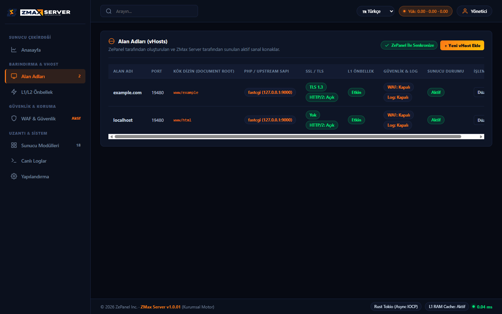

# ZMax Server

Rust ile yazılmış, yüksek performanslı ve güvenli web sunucusu. Hedef: hosting panelleriyle (zPanel dahil) birlikte çalışan, OpenLiteSpeed ile işlev denkliği sağlayan bir HTTP/HTTPS sunucusu.

*English: a high-performance web server written in Rust, aiming at feature parity with OpenLiteSpeed for hosting-panel use. Pre-release, under active development.*

> **Durum: beta öncesi, aktif geliştirme.** Üretim sunucusunda varsayılan web sunucusu olarak **kullanmayın**. Gerçek sunucu doğrulamaları sürüyor.

## İlerleme

**Son güncelleme: 2026-11-13 · sürüm 1.0.02**

İlk sürüm kapsamı 13 iş kaleminden oluşuyor. Her kalem kodlandıktan sonra bağımsız denetimden ve testlerden geçiyor.

```
Tamamlandı ve test edildi   ██████████████░░░░░░  %77
İnceleme aşamasında         ██░░░░░░░░░░░░░░░░░░  %8
Sırada                      ███░░░░░░░░░░░░░░░░░  %15
```

Kodlanmış toplam (tamamlanan + inceleme): **%85**. Gerçek sunucuda doğrulanan kısım: **yaklaşık %30**; sunucu testleri tüm kalemler bittikten sonra toplu yapılacak. Geliştirme devam ediyor.

### Son gelişmeler

- Sanal konak REST API'si hotlink ve IP erişim listesi alanlarını destekliyor.
- Önbellek temizleme (purge) alan adı ve URI bazında çalışıyor; vhost izolasyonu ve yetkilendirme korunuyor. Etiket bazlı temizleme gerçek Linux testinde doğrulandı.
- ACME doğrulama kökü yapılandırmadan (ortak ve alan adı başına) okunuyor; HTTP/2 yolunda da çalışıyor.
- HTTP/1.1 ve HTTP/2 aynı güvenlik denetim hattından geçiyor (`[vhost.acl]` dahil).
- Ters vekil güvenlik incelemesinden geçti: HTTP istek kaçırma (smuggling) kapatıldı, HTTP/2 yanıtları akıtılıyor, bağlantı ve WebSocket zaman aşımları çalışıyor.
- Ayrıcalık düşürme (root olmayan kullanıcıya geçiş), TLS anahtar izni, PHP bağlantı zaman aşımı ve ACME dizin hataları düzeltildi; yerel Linux (root) testinde doğrulandı, uzak sunucu testi sırada.
- Basic Auth: brute-force koruması, sınırlı doğrulama kuyruğu, başarılı doğrulama önbelleği ve yol atlatma (ACME, Windows) açıkları kapatıldı.

### Bileşen durumu

| Bileşen | Durum |
|---|---|
| HTTP/1.1 ve HTTP/2 istek hattı (ortak güvenlik denetimleriyle) | Tamamlandı |
| TLS (SNI, ALPN `h2`/`http/1.1`), sertifika yenileme sonrası yeniden yükleme | Tamamlandı |
| ACME HTTP-01 doğrulama yolu (ortak ve alan adı başına kök) | Tamamlandı |
| Statik dosya sunumu (Range, ETag, ön sıkıştırılmış dosyalar) | Tamamlandı |
| `.htaccess` ve yeniden yazma kuralları | Tamamlandı |
| Sanal konak yapılandırması (TOML) ve REST API ile yönetimi | Tamamlandı |
| IP erişim listeleri, hotlink koruması, WAF | Tamamlandı |
| Erişim günlüğü (NCSA, gerçek bayt sayısı) | Tamamlandı |
| Bellek ve disk önbelleği (L1/L2), alan adı/URI bazlı temizleme | Tamamlandı |
| FastCGI / PHP (temel) | Tamamlandı |
| Ters vekil (reverse proxy): HTTP/1.1 ve HTTP/2, WebSocket, SSE | Tamamlandı |
| Basic Auth (apr1, Argon2id, brute-force koruması) | Tamamlandı |
| WAF olay günlüğü | İncelemede |
| Ayrıcalık düşürme, TLS anahtar izni, PHP bağlantı zaman aşımı | Tamamlandı (yerel Linux testinde doğrulandı) |
| FastCGI havuzu, `sendfile` | İncelemede |
| OpenLiteSpeed ile yan yana denklik testleri | Sırada |
| Toplu gerçek sunucu testi (80/443 geçişi öncesi) | Sırada |

## Yönetim paneli

ZMax, yerel (loopback) bir web yönetim arayüzüyle gelir. Aşağıda sanal konak (alan adı) listesi görülüyor.



## Mimari

Cargo çalışma alanı, tek sorumluluklu küçük paketlerden oluşur:

| Paket | Görev |
|---|---|
| `zmax-bin` | Ana ikili, istek hattı, yönetim API'si |
| `zmax-httpparser`, `zmax-header` | HTTP ayrıştırma ve başlıklar |
| `zmax-tls` | TLS ve sertifika yönetimi (rustls) |
| `zmax-static`, `zmax-fastcgi`, `zmax-proxy` | Statik dosya, PHP/FastCGI, ters vekil |
| `zmax-rewrite` | `.htaccess` ve yeniden yazma |
| `zmax-security` | WAF, IP erişim listesi, hotlink |
| `zmax-cache`, `zmax-compress`, `zmax-redis` | Önbellek, gzip/brotli, Redis |
| `zmax-config` | TOML yapılandırma ve sanal konaklar |
| `zmax-runtime`, `zmax-pool`, `zmax-timeout`, `zmax-core` | Çalışma zamanı, bağlantı havuzu, zaman aşımları |

## Derleme ve çalıştırma

Gereksinimler: Rust (kararlı sürüm), Linux önerilir.

```bash
cargo build --release
./target/release/zmax -c conf/zmax.toml
```

Varsayılan test portları: HTTP `19480`, HTTPS `19483`, yönetim API'si `19486`. Örnek yapılandırma `conf/zmax.toml`, örnek sanal konaklar `conf/vhosts/` altındadır.

Testler:

```bash
cargo test --workspace
```

## Lisans

Apache-2.0. Ayrıntı için `Cargo.toml` içindeki `license` alanına bakın.
