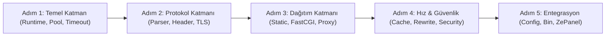

# ZMax Server (zmaxserver) Tam Teşekküllü Endüstriyel Mimari ve Geliştirme Planı

Bu belge; ZePanel ekosistemine tam entegre, Cloudflare Pingora'nın yüksek verimli asenkron ağ çekirdeği ile OpenLiteSpeed'in PHP/WordPress optimizasyonlarını birleştiren tekil bağımsız (standalone) **ZMax Server** web sunucusunun 7 katmanlı derin mimarisini ve adım adım geliştirme planını tanımlar.

- **Resmi İsim:** ZMax Server (`zmaxserver`)
- **İkili (Binary):** `zmax.exe` (Windows) / `zmax` (Linux)
- **Kontrol Paneli:** ZePanel (`zepanel.com`)
- **Web Sitesi & Repo:** `zmaxserver.com` & `github.com/zmaxserver`

---

## 1. 7 Katmanlı Derin Çekirdek Mimarisi (7-Layer Engine)

```mermaid
flowchart TD
    subgraph K0 [Katman 0: Çekirdek Sistem & G/Ç - OS Kernel]
        IOCP["Windows IOCP / Linux epoll & io_uring"]
        ZeroCopy["Sıfır Kopyalama: TransmitFile & sendfile(2)"]
        SocketOpt["SO_REUSEPORT, TCP_NODELAY, TCP_DEFER_ACCEPT"]
    end

    subgraph K1 [Katman 1: Runtime & Bellek Havuzlama - Memory & Runtime]
        Runtime["zmax-runtime: Asenkron Worker & Thread Pinning"]
        Pool["zmax-pool: BytesMut Bellek Havuzu & Connection Keep-Alive Havuzu"]
    end

    subgraph K2 [Katman 2: TLS, Güvenlik & Zaman Aşımı - Network & Security]
        TLS["zmax-tls: OpenSSL / Rustls (TLS 1.3, ALPN, SNI, OCSP)"]
        Timeout["zmax-timeout: Header, Body, Keep-Alive Zaman Aşımları & Slowloris Kalkanı"]
    end

    subgraph K3 [Katman 3: HTTP Protokolü & Ayrıştırıcı - HTTP Engine]
        Parser["zmax-httpparser: SIMD Destekli Sıfır Kopyalama HTTP/1.1 & HTTP/2 Parser"]
        Header["zmax-header: HeaderMap, Normalizasyon, CORS, HSTS, CSP"]
    end

    subgraph K4 [Katman 4: Yönlendirme, Proxy & Uygulama Motorları - Upstream & SAPI]
        FCGI["zmax-fastcgi: PHP-FPM / LSPHP İkili Protokol İstemcisi"]
        AppServer["zmax-appserver: Node.js, Python WSGI, Go Süreç Yöneticisi & Supervisor"]
        Proxy["zmax-proxy: Ters Proxy, WebSocket & Yük Dengeleme"]
        Static["zmax-static: TransmitFile & sendfile Statik Dağıtım"]
        TaskRunner["zmax-taskrunner: Composer, WP-CLI, Artisan Güvenli Komut Yürütücü"]
    end

    subgraph K5 [Katman 5: Hız, Önbellek & Güvenlik - Speed & Protection]
        Cache["zmax-cache: L1 RAM Önbellek, Etiketli Purge (LSCache Dengi)"]
        Rewrite["zmax-rewrite: WordPress try_files & .htaccess Regex Çözümleyici"]
        Security["zmax-security: WAF, DDoS Kalkanı, wp-login Brute-Force Koruması"]
        Compress["zmax-compress: Gzip, Deflate, Brotli Uçuş Anı Sıkıştırma"]
    end

    subgraph K6 [Katman 6: Yönetim, CLI, Yapılandırma & Çıktı - Management & Binary]
        Config["zmax-config: TOML vHost Yapılandırması & Dinamik Graceful Reload"]
        Metrics["zmax-metrics: ZePanel Canlı İstatistik API'si (/zmax-status JSON)"]
        CLI["zmax-cli: ZMax Yönetim CLI'si (zmax status/reload/test/purge)"]
        Bin["zmax-bin: Tekil İkili (zmax.exe / zmax)"]
    end

    K0 --> K1 --> K2 --> K3 --> K4 --> K5 --> K6
```



---

## 2. Modüler Kod Mimarisi (Cargo Workspace)

ZMax Server, 14 adet tek sorumluluk prensibine (Single Responsibility Principle) sahip modülden oluşur:

```text
D:\zmaxserver\
├── Cargo.toml                   # Workspace kök yapılandırması
├── doc\                         # Mimari belgeleri ve geliştirici araçları
│   ├── GELISTIRME_PLANI.md
│   ├── MIMARI_VE_PLAN.md
│   └── tools\                   # Rustup ve derleyici araçları
├── ornekmimariler\              # Pingora ve OpenLiteSpeed kaynak referansları
└── crates\
    ├── zmax-runtime\            # Asenkron worker döngüsü, CPU affinity, sinyaller
    ├── zmax-pool\               # Buffer Pool (bellek havuzu) & Connection Pool
    ├── zmax-tls\                # OpenSSL/Rustls el sıkışması, SNI, ALPN
    ├── zmax-timeout\            # Slowloris kalkanı, okuma/yazma/boşta zaman aşımları
    ├── zmax-httpparser\         # Zero-copy HTTP/1.1 ve HTTP/2 akış ayrıştırıcısı
    ├── zmax-header\             # HTTP başlık haritası, normalizasyon, güvenlik başlıkları
    ├── zmax-fastcgi\            # PHP-FPM / LSPHP ikili protokol motoru
    ├── zmax-proxy\              # Ters proxy, WebSocket desteği, yük dengeleyici
    ├── zmax-static\             # TransmitFile (Win) / sendfile (Linux) statik dağıtım
    ├── zmax-cache\              # L1 bellek içi RAM önbellek ve etiketli Purge motoru
    ├── zmax-rewrite\            # WordPress ve .htaccess regex yönlendirme motoru
    ├── zmax-security\           # WAF, DDoS ve wp-login kaba kuvvet kalkanı
    ├── zmax-config\             # TOML vHost yapılandırma ve graceful reload
    └── zmax-bin\                # Tekil çalıştırılabilir ana ikili (zmax.exe / zmax)
```

---

## 3. Katman Katman Teknik Görevler ve Teknolojiler

| Modül | Görevi ve Sorumluluğu | Kullanılan Çekirdek Teknolojiler |
| :--- | :--- | :--- |
| **`zmax-runtime`** | CPU çekirdeği başına worker thread başlatma, Tokio runtime'ını yönetme, SIGTERM/SIGHUP ile sıfır kesintili reload (graceful reload). | `tokio`, `core_affinity`, `signal-hook` |
| **`zmax-pool`** | Her istekte `malloc`/`free` yapmamak için `BytesMut` tampon havuzu; PHP ve backend için sürekli açık Keep-Alive bağlantı havuzu. | `bytes`, `crossbeam-queue`, `deadpool` |
| **`zmax-tls`** | TLS 1.3/1.2 şifreleme, SNI tabanlı çoklu domain sertifikaları, HTTP/2 için ALPN müzakeresi, OCSP zımbalama. | `rustls` veya `openssl`, `tokio-rustls` |
| **`zmax-timeout`** | Slowloris saldırılarına karşı koruma; Header okuma zaman aşımı (10s), Body zaman aşımı (30s), Keep-Alive boşta kalma süresi (65s). | `tokio::time`, `tokio::select!` |
| **`zmax-httpparser`** | Soketten gelen baytları heap'e kopyalamadan (`&[u8]` slice) doğrudan ayrıştıran ultra hızlı streaming parser. | `httparse`, SIMD optimizasyonları |
| **`zmax-header`** | İstek ve yanıt başlıklarını yönetme, Header injection, CORS kuralları, Güvenlik başlıkları (HSTS, CSP, X-Frame-Options). | `http::header::HeaderMap`, `bytes` |
| **`zmax-fastcgi`** | PHP-FPM veya LSPHP süreçlerine ikili FastCGI paketleri gönderme ve yanıtı çözme (Named Pipe ve Unix Soket desteği). | FastCGI RFC Binary Protokolü |
| **`zmax-proxy`** | Dinamik Node.js, Python, Go backend servislerine ters proxy yapma ve WebSocket (`Upgrade: websocket`) tünelleme. | `hyper`, `tokio-tungstenite` |
| **`zmax-static`** | CSS/JS/Görsel/Video dosyalarını RAM'e hiç almadan doğrudan çekirdekten ağ kartına basma. | Windows `TransmitFile`, Linux `sendfile(2)` |
| **`zmax-cache`** | WordPress sayfalarını RAM'de saklama (`< 0.2ms` yanıt), etiketli önbellek temizleme (LSCache dengi Purge API), Cache Stampede kalkanı. | `moka` (Concurrent LRU/TinyLFU Cache) |
| **`zmax-rewrite`** | WordPress kalıcı bağlantılarını (`try_files $uri $uri/ /index.php?$args`) ve temel .htaccess Rewrite kurallarını bellekte çözme. | `regex`, Matcher State Machine |
| **`zmax-security`** | IP bazlı hız sınırlama (Token Bucket Rate Limiting), WordPress `wp-login.php` kaba kuvvet kalkanı, basit WAF kuralları. | `dashmap`, Token Bucket |
| **`zmax-config`** | TOML formatında sunucu ve site (vHost) ayarlarını okuma; dosya değiştiğinde bağlantıları kesmeden reload etme. | `serde`, `toml`, `notify` |
| **`zmax-bin`** | Tüm bu 13 modülü tek bir derlenmiş dosyada (`zmax.exe` / `zmax`) birleştiren ve `services.msc` servisi yapabilen ana giriş noktası. | `windows-service` (Win), `mimalloc` |

---

## 4. Sıfırdan Adım Adım İnşa Sırası (İnşaat Sıralaması)



1. **Adım 1 (Temel / Altyapı):** `zmax-runtime`, `zmax-pool`, `zmax-timeout` inşa edilir. Asenkron worker'lar, bellek havuzları ve zaman aşımı korumaları ayağa kalkar.
2. **Adım 2 (HTTP & TLS):** `zmax-httpparser`, `zmax-header`, `zmax-tls` inşa edilir. Soketten gelen ham baytlar HTTP isteğine dönüştürülür ve güvenli TLS el sıkışması yapılır.
3. **Adım 3 (İçerik & PHP):** `zmax-static` ve `zmax-fastcgi` inşa edilir. Statik dosyalar ve PHP sayfaları ilk kez canlıda sunulur.
4. **Adım 4 (LiteSpeed Dengi Hız):** `zmax-cache` ve `zmax-rewrite` inşa edilir. WordPress kalıcı bağlantıları ve milisaniyelik sayfa önbelleği devreye girer.
5. **Adım 5 (Ürünleştirme):** `zmax-security`, `zmax-config` ve `zmax-bin` birleştirilir. `zmax.exe` çıktısı alınır, Windows servisi ve ZePanel entegrasyonu tamamlanır.

---

## 5. `v1.1+` Hedef Mimari İlkeleri (Az CPU · Sıfır Güvenlik Zafiyeti · Çoklu İşlem · Evrensel Uyumluluk)

Çekirdek `v1.0.01` sürümünün ardından tam kurumsal bağımsız (LiteSpeed'siz) üretim standardına geçiş aşağıdaki 4 sütun üzerinden planlanır *(ayrıntılı teknik tasarım ve durum ayrımı için [`mimari/EKLENECEK_MIMARI.md`](file:///D:/zmaxserver/doc/mimari/EKLENECEK_MIMARI.md) belgesine bakın)*:

1. **Az CPU (Zero-Copy & Minimum Syscall):**
   - `core_affinity` ile worker thread sabitleme + Linux `SO_REUSEPORT` çekirdek başına kabul kuyruğu,
   - Statik dağıtımda `sendfile(2)` / `TransmitFile` + önceden sıkıştırılmış `.zst`/`.br`/`.gz` **sidecar** sunumu,
   - FastCGI tarafında `FCGI_KEEP_CONN` kalıcı bağlantı havuzu, streaming `FCGI_STDOUT` ve `X-Accel-Redirect` / `X-Sendfile` devri,
   - `zmax-cache` içine **LSCache (`X-LiteSpeed-*`) başlık köprüsü**, kanallı toplu (batched) asenkron log yazımı ve `mtime` önbellekli `.htaccess` ayrıştırıcı.
2. **Sıfır Güvenlik Zafiyeti (Defense-in-Depth & İzolasyon):**
   - FastCGI'de **HTTPoxy (`CVE-2016-5385`)** `Proxy:` başlığı engeli, `cgi.fix_pathinfo` yol enjeksiyonu sıfırlaması, `X-Accel-Redirect` iç prefix doğrulaması,
   - Port `80`/`443` açılışı sonrası **`setgid`/`setuid` (`nobody`) yetki düşürme** + `CAP_NET_BIND_SERVICE` + çok kiracılı **`suEXEC` UID/GID PHP-FPM UDS** izolasyonu,
   - HTTP/1.1 Request Smuggling (`CL.TE`/`TE.CL`) katı reddi, OCSP Stapling, Strict SNI, alan adına özel WAF (`waf_enabled`, `waf_exclude_paths`), `zmax-auth` ve `zmax-botshield`.
3. **Çoklu İşlem & Yüksek Eşzamanlılık:**
   - Master + Multi-Worker / `SO_REUSEPORT` mimarisi ve **`SIGUSR2` FD devri ile 0 ms kesintisiz ikili yükseltme**,
   - Çoklu PHP upstream yük dengeleme (`least_conn` + gecikme ölçümü + pasif sağlık kontrolü), RoadRunner modeli **`max_jobs`/TTL supervisor (`zmax-appserver`)** ve küme içi ban/önbellek eşitleme (`zmax-redis`).
4. **Her Şeye Uyumlu Evrensel Yapı:**
   - **Protokoller:** HTTP/1.1, **HTTP/2 (`h2`)**, **HTTP/3 (`zmax-quic`)**, WebSocket, **`PROXY Protocol v1/v2`**, dahili **`zmax-acme` (`HTTP-01`, `TLS-ALPN-01`, `DNS-01`)**,
   - **Ekosistem & Paneller:** Windows (`IOCP` + TCP/Named Pipe PHP + IIS/Kestrel proxy) + Linux x64/ARM64 `musl`, alt-dizin `.htaccess`, **alan adına özel `access_log` & `error_log`** (`Combined`/JSON + `Trace ID`) ve tam CRUD Panel API (`19480–19486` + `80/443`).

> 📌 Güncel modül durumu ve rakip kıyaslaması: [`TAM_MODUL_VE_OZELLIK_MATRISI.md`](file:///D:/zmaxserver/doc/TAM_MODUL_VE_OZELLIK_MATRISI.md) · [`FERRON_VE_LITESPEED_KARSILASTIRMA.md`](file:///D:/zmaxserver/doc/FERRON_VE_LITESPEED_KARSILASTIRMA.md).
