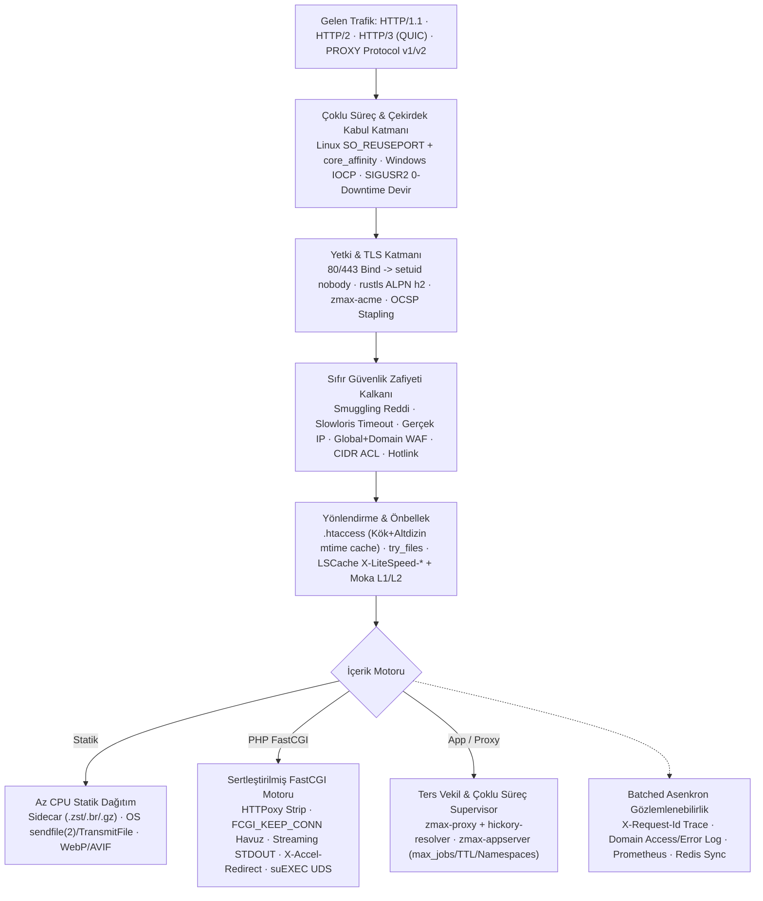

# ZMax Server — Az CPU, Sıfır Güvenlik Zafiyeti, Çoklu İşlem ve Evrensel Uyumluluk Hedef Mimarisi (`v1.1+`)

Bu belge; [`D:\zmaxserver`](file:///D:/zmaxserver) çekirdeğinin (`v1.0.01`) üretim sertleştirmesi ve tam bağımsız (LiteSpeed'siz) yüksek ölçekli web sunucusuna evrilmesi için **4 temel mühendislik sütunu** üzerine kurulu eklenecek mimari standardını tanımlar:
1. **Az CPU** (Sıfır Kopyalama, Çekirdek Sabitleme, Havuzlama, Önbellek)
2. **Sıfır Güvenlik Zafiyeti** (Derinlemesine Savunma, İzolasyon, Sıfır Güven)
3. **Çoklu İşlem & Yüksek Eşzamanlılık** (Multi-Process / Worker-per-Core, `SO_REUSEPORT`, Kesintisiz Yükseltme)
4. **Her Şeye Uyumlu Evrensel Yapı** (Windows/Linux, HTTP/1.1–2–3, CMS/Framework, Tüm Hosting Panelleri)

Referans alınan doğrulanmış kaynaklar: [`TAM_MODUL_VE_OZELLIK_MATRISI.md`](file:///D:/zmaxserver/doc/TAM_MODUL_VE_OZELLIK_MATRISI.md), [`FERRON_VE_LITESPEED_KARSILASTIRMA.md`](file:///D:/zmaxserver/doc/FERRON_VE_LITESPEED_KARSILASTIRMA.md) ve GitHub FastCGI / Web Server incelemeleri (`User65k/async-fcgi`, `jmjoy/fastcgi-client-rs`, `ferronweb/ferron`, `caddyserver/caddy`, `h2o/h2o`, `litespeedtech/openlitespeed`, `nginx/unit`, `webserver-llc/angie`, `lighttpd/lighttpd1.4`, `roadrunner-server/roadrunner`, `dunglas/frankenphp`).

> **Doğruluk İlkesi:** Her bölümde [`crates/`](file:///D:/zmaxserver/crates) kodundaki **"Mevcut Gerçek (`v1.0.01`)"** ile **"Eklenecek Hedef Mimari (`v1.1+`)"** kesin çizgiyle ayrılmıştır.

---

## 1. Bütüncül 4 Sütunlu Hedef Mimari Akışı

---

## 2. Sütun 1 — Az CPU Mimarisi (Minimum Çevrim, Sıfır Kopyalama)

### 2.1. Mevcut Gerçek (`v1.0.01`) vs Eklenecek Hedefler
| Bileşen | Mevcut Gerçek (`v1.0.01`) | Eklenecek Az-CPU Mimarisi (`v1.1+`) |
| :--- | :--- | :--- |
| **Worker & Çekirdek** | Tek Tokio runtime (`available_parallelism`); `cpu_affinity = true` yalnızca config'de okunur. | **Thread-per-Core + `core_affinity`:** Her worker thread fiziksel çekirdeğe sabitlenir; `SO_REUSEPORT` ile her çekirdek kendi accept kuyruğundan kilit çekişmesi olmadan soket alır. |
| **Statik Dosya & Sıkıştırma** | `2 MiB` altı RAM tampon, üstü `BufferPool` 64 KiB akış; yalnızca anlık Gzip. | **OS Zero-Copy (`sendfile(2)` / `TransmitFile`) + Precompressed Sidecar (`.zst`/`.br`/`.gz`):** Diskte hazır sıkıştırılmış yan dosya varsa sıkıştırma CPU'su `%0`'a iner; büyük düz dosyalarda user-space kopyası atlanır. |
| **FastCGI İletişimi** | [`zmax-fastcgi`](file:///D:/zmaxserver/crates/zmax-fastcgi/src/lib.rs#L674) `FCGI_KEEP_CONN = false` gönderir ve her istekte yeni soket açar; tüm stdout `Vec<u8>` içinde birikir. | **`FCGI_KEEP_CONN = true` Havuzu + Streaming + `X-Accel-Redirect`:** Soket el sıkışma CPU'su sıfırlanır; başlıklar biter bitmez gövde akıtılır; büyük indirmeler PHP'den alınıp statik sıfır-kopyalama hattına devredilir. |
| **Dinamik PHP Önbelleği** | Moka L1 + L2 Disk + Tag Purge + Stampede Shield + SWR aktif; haricî başlık köprüsü yok. | **LSCache Başlık Köprüsü (`X-LiteSpeed-Cache-Control`, `X-LiteSpeed-Tag`, `X-LiteSpeed-Purge`, `_lscache_vary`):** WordPress PHP çalışmasını `%95+` oranında L1 RAM önbellekte keser. |
| **Loglama & `.htaccess`** | Her istekte doğrudan dosya append syscall'ı (`append_access_log_limit`); her istekte `<doc_root>/.htaccess` disk okuma/parse. | **Kanallı Batch Asenkron Log Yazıcı** (`BufWriter` + zaman/boyut tabanlı flush) ve **`mtime` + yol önbellekli `.htaccess` ayrıştırıcı** (`DashMap`) ile disk ve regex derleme CPU'sunun sıfırlanması. |
| **Bellek Ayırıcı** | Windows `mimalloc`; Linux `musl` varsayılan ayırıcı. | Linux `musl` hedeflerinde `tikv-jemallocator` / `mimalloc` kıyaslaması ve düşük parçalanmalı arena ayarı; HTTP/2 HPACK tablolarında sıfır kopyalama dilimler. |

---

## 3. Sütun 2 — Sıfır Güvenlik Zafiyeti Mimarisi (Derinlemesine Savunma)

### 3.1. FastCGI & PHP Uygulama Güvenliği (En Kritik Katman)
1. **HTTPoxy (`CVE-2016-5385`) Mutlak Koruması:**
   - **Mevcut Durum:** [`header_name_to_cgi_env`](file:///D:/zmaxserver/crates/zmax-fastcgi/src/lib.rs#L306-L354) gelen `Proxy:` başlığını `HTTP_PROXY` olarak iletebilir.
   - **Hedef Kural:** `Proxy` başlığı FastCGI ortam haritası oluşturulurken istisnasız silinir (`HTTP_PROXY` asla dış istemciden set edilemez).
2. **`cgi.fix_pathinfo` Enjeksiyonlarına Karşı Fiziksel Doğrulama:**
   - `/avatar.jpg/zararli.php` tarzı sahte uzantı saldırılarına karşı, PHP'ye gönderilecek gerçek `.php` dosyası disk üzerinde `canonicalize` + `resolve_root_symlink` + kök sınır (`starts_with`) kontrolünden geçmeden FastCGI'ye asla iletilmez.
3. **`X-Accel-Redirect` / `X-Sendfile` Güvenli İç Devir:**
   - İstemciye asla ham `X-Accel-Redirect` başlığı dönülmez; yalnızca tanımlı iç sanal öneklerde (`internal_paths`), `..`/gizli segment denetimi sonrası sunulur.
4. **Çok Kiracılı İzolasyon (`suEXEC` + Per-VHost Soket + `allowed_clients`):**
   - Her alan adı için ayrı Linux UID/GID altında çalışan izole PHP-FPM Unix soketi (`unix:/run/php-fpm/<domain>.sock`), TCP kullanımda `listen.allowed_clients = 127.0.0.1` ve siteye özel `chroot` / `open_basedir` şablonu.

### 3.2. Süreç, İşletim Sistemi ve Ağ Sertleştirmesi
1. **Yetki Düşürme (`Privilege Drop`) & `CAP_NET_BIND_SERVICE`:**
   - **Mevcut Durum:** [`zmax.service`](file:///D:/zmaxserver/packed/linux-x64/systemd/zmax.service) `User=root` çalışır; `zmax.toml` `user = "nobody"` alanı çalışma zamanında `setuid` uygulamaz.
   - **Hedef Kural:** Port `80`/`443` dinleyicileri bağlandıktan hemen sonra süreç `setgid`/`setuid` ile `nobody` kullanıcısına düşer veya `AmbientCapabilities=CAP_NET_BIND_SERVICE`, `NoNewPrivileges=yes`, `ProtectSystem=strict`, `PrivateTmp=yes` ile çalışır.
2. **HTTP Request Smuggling & Ayrıştırıcı Sıkılığı:**
   - Çakışan `Content-Length` + `Transfer-Encoding` (`CL.TE`/`TE.CL`), çift farklı `Content-Length`, CR/LF başlık enjeksiyonu ve geçersiz `Host` değerleri HTTP/1.1 ve HTTP/2 katmanlarında **bağlantı sonlandırılarak (`400 Bad Request`)** reddedilir.
3. **Protokol, TLS ve Gerçek IP Güvenliği:**
   - `zmax-httpparser` + `resolve_real_ip`: Yalnız `trusted_proxies` içindeki eşlerin gönderdiği `CF-Connecting-IP`/`X-Forwarded-For`/`PROXY Protocol` başlıklarına güvenilir (IP sahteciliği engeli).
   - TLS 1.2/1.3 + OCSP Stapling + Strict SNI (bilinmeyen hostta sertifika sızdırmayı engelleme seçeneği) + QUIC `0-RTT` replay koruması (`POST`/mutasyon isteklerinde `0-RTT` reddi).
4. **Alan Adına Özel WAF, Kontrol API & İkili Zırh:**
   - Global WAF'a ek olarak `VHostSecuritySection` içinde **`waf_enabled`**, **`wp_brute_force`**, **`waf_exclude_paths`**; `PUT /api/v1/vhosts` üzerinden tam CIDR `allow_ips`/`deny_ips` & `hotlink_protection` yönetimi.
   - `0.0.0.0` dinlemede zorunlu API/Admin Token (mevcut), `zmax-auth` (Argon2 `.htpasswd`), `zmax-botshield` ve [`zmax-obfuscate`](file:///D:/zmaxserver/doc/sifleme.md) ikili koruma.

---

## 4. Sütun 3 — Çoklu İşlem ve Ölçeklenebilir Eşzamanlılık Mimarisi

1. **Çoklu Süreç / Çoklu Worker Modeli (Master + Worker + `SO_REUSEPORT`):**
   - Linux'ta ana yönetici süreç (Master) yapılandırmayı doğrular, soketleri/yetkileri hazırlar ve çekirdek sayısı kadar işçi (Worker) veya çekirdek başına `SO_REUSEPORT` soketli worker havuzu yönetir; bir işçi çökse bile diğer işçiler trafiği kesmeden hizmete devam eder ve yönetici çöken işçiyi anında yeniden doğurur.
2. **Sıfır Kesintili İkili Yükseltme (`SIGUSR2` FD Devri / `SO_REUSEPORT` Drain):**
   - **Mevcut Durum:** `SIGHUP` ve `/api/v1/reload` aynı süreç içinde config/vHost/SNI/modül yeniler; yeni derlenen ikiliye geçmek için kısa `restart` gerekir.
   - **Hedef:** Yeni `zmax` süreci mevcut dinleyici FD'lerini devralır (`SO_REUSEPORT` veya Unix SCM_RIGHTS), yeni bağlantıları devralırken eski süreç aktif `keep-alive` ve uzun PHP/WebSocket isteklerini güvenle tamamlayıp (`graceful drain`) kapanır — **`0` düşen istek**.
3. **Çoklu PHP / AppServer Yük Dengeleme & Supervisor (`RoadRunner` + `H2O` + `Caddy` Modeli):**
   - `[vhost.php] upstreams = [...]` ile birden çok PHP-FPM soketi/sunucusu arasında `least_conn` veya gecikme ölçümüne dayalı (`Angie` modeli) yük dengeleme + pasif sağlık kontrolü + ayrık `dial_timeout` / `io_timeout`.
   - `zmax-appserver`: Node.js, Python (WSGI/ASGI), Go ve yönetilen `php-cgi` işçileri için **`num_workers`, `max_jobs` (belirli istek sonrası temiz yenileme), bellek tavanı, execution TTL** ve Linux Namespaces izolasyonlu süreç yöneticisi.
4. **Dağıtık Küme Eşitleme (`zmax-redis`):**
   - [`zmax-redis`](file:///D:/zmaxserver/crates/zmax-redis/src/lib.rs) istemcisinin `zmax-bin`'e bağlanmasıyla çoklu süreçler ve birden çok sunucu arasında saldırgan IP ban, rate-limit sayacı ve önbellek tag purge olaylarının gerçek zamanlı paylaşımı.

---

## 5. Sütun 4 — Her Şeye Uyumlu Evrensel Yapı

| Uyumluluk Alanı | Mevcut (`v1.0.01`) | Eklenecek Tam Uyumluluk (`v1.1+`) |
| :--- | :--- | :--- |
| **İşletim Sistemi & CPU** | Windows x64 (`IOCP`), Linux x64 & ARM64 (`musl` statik) | Windows **Named Pipe (`\\.\pipe\...`) PHP** + IIS/Kestrel `.aspx` proxy şablonu; Linux `epoll`/`io_uring` + tam `systemd` `Type=notify` desteği. |
| **Ağ Protokolleri** | HTTP/1.1, TLS 1.2/1.3 (ALPN `http/1.1`), WebSocket (`Upgrade`) | **HTTP/2 (`h2`)**, **HTTP/3 (`zmax-quic` / QUIC UDP)**, **`PROXY Protocol v1/v2` (`ppp` — HAProxy/Cloudflare L4 arkası)**, dahili **`zmax-acme` (`HTTP-01`, `TLS-ALPN-01`, `DNS-01`)**. |
| **CMS & Çerçeveler** | WordPress/Laravel/OpenCart/XenForo `.htaccess` (kök) & `try_files` & `PATH_INFO`, WebP/AVIF | **Alt-dizin `.htaccess`** (`/blog/.htaccess`), **LSCache `X-LiteSpeed-*` protokolü**, `X-Accel-Redirect`, Node/Python/Go **`zmax-appserver`**. |
| **Hosting Panelleri & Loglar** | `19480–19486` sıfır çakışmalı portlar, HTTP Control API + UDS, global access/error log | **Alan adına özel `access_log` & `error_log`** (`Combined`/JSON + **`X-Request-Id` Trace ID** + `max_log_size_mb` rotasyon), **`GET /api/v1/logs?domain=...`**, tam **vHost Security/ACL/Proxy CRUD** + **`80/443` panel/webmail** şablonları. |

---

## 6. Önerilen TOML Yapılandırma Uzantıları (`v1.1+`)

Mevcut [`conf/zmax.toml`](file:///D:/zmaxserver/conf/zmax.toml) ve `conf/vhosts/<domain>.toml` ile **%100 geriye uyumlu (`#[serde(default)]`)** kalacak hedef alanlar:
- **`[vhost.logging]`:** `enabled`, `access_log` (ör. `"/var/www/vhosts/<domain>/logs/access.log"` veya varsayılan `logs/vhosts/<domain>.access.log`), `error_log`, `format` (`"combined"` / `"json"`), `max_log_size_mb`, `also_write_global`.
- **`[vhost.security]` (genişleme):** mevcut `force_https`, `hotlink_protection`, `allow_ips`, `deny_ips` alanlarına ek `waf_enabled`, `wp_brute_force`, `waf_exclude_paths`.
- **`[vhost.php]` (genişleme):** `upstreams = []`, `lb_policy = "least_conn"`, `keep_conn = true`, `pool_max_idle = 32`, `dial_timeout_ms = 3000`, `resolve_root_symlink = true`, `allow_x_accel_redirect = true`, `internal_redirect_prefixes = ["/_internal/"]`, `capture_stderr = true`.

---

## 7. Aşamalı Uygulama Fazları ve Zorunlu Kabul Testleri

| Faz | Kapsam | Zorunlu Test & Doğrulama Kriteri |
| :--- | :--- | :--- |
| **Faz 1 — Linux Bağımsız & Panel Eksikleri** | Alan adı `access_log`/`error_log` (batched writer + rotasyon), alan adı WAF + tam `PUT /api/v1/vhosts` CRUD, alt-dizin `.htaccess` önbelleği, WebAdmin ACL UI | Linux VM üzerinde `systemd` + `php-fpm` ile canlı WordPress permalink, domain bazlı log yazımı, API üzerinden `allow_ips`/`hotlink`/`waf` güncellemesi doğrulanmalı. |
| **Faz 2 — FastCGI Güvenlik & Hız** | `HTTP_PROXY` (HTTPoxy) engeli, `FCGI_KEEP_CONN` havuzu, streaming `FCGI_STDOUT`, `X-Accel-Redirect`, ayrık `dial_timeout` + çoklu upstream LB | `Proxy:` başlığı PHP `getenv('HTTP_PROXY')` içinde asla görünmemeli; 100 MB FastCGI akışında RAM artışı sabit kalmalı; keep-alive soket yeniden kullanımı test edilmeli. |
| **Faz 3 — Çoklu Süreç, HTTP/2–3, Zero-Copy & Otomasyon** | `setuid` (`nobody`) + `core_affinity` + `SO_REUSEPORT` + `SIGUSR2` yükseltme, HTTP/2 (`h2`) & HTTP/3 (`QUIC`), `zmax-acme` + OCSP, LSCache köprüsü, Brotli/Zstd + sidecar + `sendfile(2)`, `zmax-appserver`, `zmax-redis`, `PROXY Protocol` | Yük altında `SIGUSR2` sırasında `0` kopan istek; `curl --http2` ve `--http3`; non-root süreç doğrulaması; otomatik ACME yenileme; `Trace ID` korelasyonu test edilmeli. |
