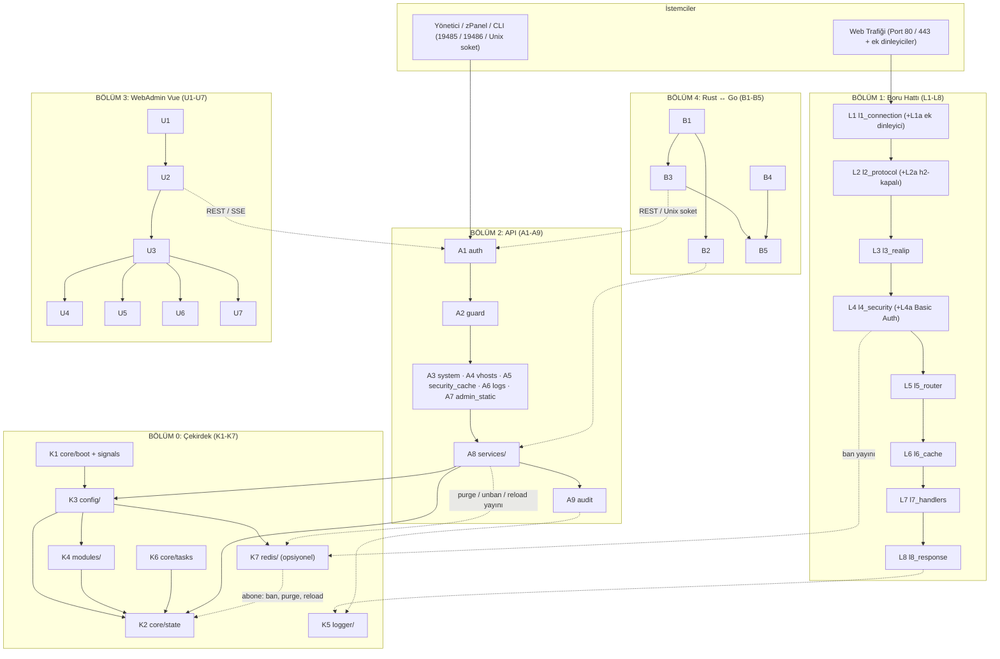

# ZMax Server — 36 Parçalı Katmanlı Mimari Şartnamesi (v3.1, kodla eşlenmiş)

> v3.1, v3.0 planının **gerçek koda göre güncellenmiş** hâlidir. Taban: `main` = `birlesme2` = `dff16c6` (M1–M12 taşıma + M13–M20 yeni özellik birleşmiş; tam test 494 geçti, `doc/bitti/BIRLESME2.md`). Önceki plan sürümü `eski_v2/onceki_plan_sema/` içinde, v2.0 (18 parça) belgeleri `eski_v2/` içinde saklıdır.
> Her dosya yolu ve satır numarası `agaclar/birlesme2/crates/zmax-bin/src` altından okunarak doğrulanmıştır (satır numaraları `dff16c6` içindir; sonraki commit'lerde kayabilir). Doğrulama kaydı: `bitti/SEMA_GUNCEL.md`.

## 1. Durum özeti (kodla karşılaştırma)
Planlanan taşıma yapıldı: `api.rs`, `logger.rs`, `h2_engine.rs` bölünüp silindi; `modules_runtime.rs` yalnız testleri kaldı; `main.rs` yalnız `main()` (45) + testler. Kalan sapmalar açıkça işaretlidir (§8).

| Kod | Durum | Gerçek yer (kök: `crates/zmax-bin/src`) |
|---|---|---|
| K1 boot/sinyal | Var (kısmi: kopya) | `core/boot.rs` (`run` 228), `core/signals.rs`; **SIGHUP/SIGUSR1 ve bakım görevi `boot.rs` içinde satır içi de yazılı** (825-866, 425-440); `spawn_signal_handlers`/`spawn_background_tasks` tanımlı ama **hiçbir yerden çağrılmıyor** |
| K2 durum | Var | `core/state.rs` (`RuntimeState` 36, `ServerState` 51, `CONFIG_GENERATION` 49) |
| K3 yapılandırma | Var | `config/reload.rs` (`reload_runtime_state_with_alpn` 66, `refresh_tls_certs` 11), `config/acme.rs`; ayrıştırma `zmax-config` crate'inde |
| K4 modüller | Var | `modules/policy.rs` (`compile_policies` 152), `modules/registry.rs` |
| K5 logger | Var | `logger/` (`mod.rs` `AsyncLogManager` 87, `worker.rs`, `format.rs`, `rotate.rs`, `tail.rs`) |
| K6 görevler | Kısmi | `core/tasks.rs` (18 satır, bakım döngüsü; **çağrılmıyor**) ; TLS yenileme `config/reload.rs` + boot'ta tek sefer |
| K7 Redis | Var (abone + yayın) | `redis/client.rs`, `redis/sync.rs`, `redis/events.rs` (`spawn_subscriber` 52; boot'ta çağrılır `core/boot.rs:440`) |
| L1–L8 | Var (parça parça) | `pipeline/l1_…l8_*.rs`; **sıra orkestrasyonu `web_engine/pipeline_h1.rs` ve `pipeline_h2.rs` içinde** (§8) |
| A1–A9 | Var | `api/` (auth, guard, audit, bridge, routes/, services/) |
| U1–U7 | Var | `admin/` (index.html, js/api_client.js, app.js, views/*) |
| B1–B5 | Kısmi: Go tarafı var, ZMax deposunda değil | Rust: `api/bridge.rs`; Go + sözleşme: `D:\zmaxserver\katmanlizmax\go\` (`contract/`, `zmaxbridge/`, `lifecycle/`) — `git ls-files` altında yok |

**Alt parçalar (M21, şemada yeri olmayan 3 parça):** parça numaraları değişmedi, toplam **36 kalır**; alt parça (a-eki) sayılmaz.

| Alt parça | Bağlı | Dosya | Anlamı |
|---|---|---|---|
| **L1a** Ek dinleyici | L1 (+L7 proxy) | `web_engine/extra_listeners.rs` (`reconcile` 167, `start_one` 82, `handle_conn` 312, `handle_request` 368) | `[[listeners.extra]]`: panel portlarında ek TLS dinleyici + sabit arka uca ters vekil |
| **L4a** Basic Auth | L4 | `security_pipeline.rs` (`evaluate_basic_auth` 15, `build_unauthorized_response` 45, `build_auth_denial` 98); motor `zmax-security/src/basic_auth.rs` | vhost başına parola kapısı |
| **L2a** h2-kapalı vhost | L2 (+L5) | `web_engine/pipeline_h2.rs:84-94` (421); bayrak `pipeline/l5_router.rs:66,438` (`tls_http2`) | `tls.http2=false` vhost'a h2 isteği → 421 |

## 2. Üç Temel İlke
1. **Tek sorumluluk:** her parça tek iş yapar.
2. **Her yönetim işlemi API'den geçer:** WebAdmin, zPanel, CLI aynı API'nin istemcisidir (`04`).
3. **Sıra kodun yaptığı sıradır:** katman sırası `web_engine/pipeline_h1.rs` / `pipeline_h2.rs` içindeki gerçek yürütme sırasından alınmıştır.

## 3. Mimari Şema



## 4. Parça Listesi (Toplam 36 Parça; alt parçalar hariç)
**Bölüm 0 (7):** K1–K7 → `05`  ·  **Bölüm 1 (8):** L1–L8 (+L1a, L2a, L4a) → `01`  ·  **Bölüm 2 (9):** A1–A9 → `02`  ·  **Bölüm 3 (7):** U1–U7 → `03`  ·  **Bölüm 4 (5):** B1–B5 → `07`
Güvenlik: `04` · Taşıma sonucu (eski→yeni dosya eşlemesi): `06`.

## 5. Bağımlılık Kuralları
- L (boru hattı) ve A (API) birbirini içe aktarmaz; ortak nokta K2 (`ServerState`). Denetim aracı: `tools/tasima_kontrol.py yon` (birlesme2'de GEÇTİ). **Bilinen istisna:** `web_engine/pipeline_h1.rs` `crate::redis`, `crate::api` çağırır (orkestratör, §8).
- Bir katman yalnız kendinden önceki çıktıyı ve K2'yi okur; L8 dışında istemci soketine yazılmaz (kodda `write_error_response`/`write_http_response` L8'de; pratikte pipeline_h1/h2 de bunları çağırır).
- API rotaları iş mantığını içermez, A8 servislerini çağırır.
- `zmax-bin` dışına `ServerState` sızmaz.

## 6. Gerçek Dizin Ağacı (birlesme2 / main)

```
crates/zmax-bin/src/
├── main.rs                  main() 45; geri kalanı bütünleşik testler (50-2873)
├── acme_runtime.rs          2 satır (yeniden dışa aktarım)
├── modules_runtime.rs       yalnız testler (505 satır)
├── security_pipeline.rs     L4 yeniden dışa aktarım + L4a Basic Auth (213)
├── core/       boot.rs  signals.rs  state.rs  tasks.rs  mod.rs                  (K1 K2 K6)
├── config/     reload.rs  acme.rs  mod.rs                                        (K3)
├── modules/    policy.rs  registry.rs  mod.rs                                    (K4)
├── logger/     mod.rs  worker.rs  format.rs  rotate.rs  tail.rs  tests.rs        (K5)
├── redis/      client.rs  sync.rs  events.rs  mod.rs                             (K7)
├── pipeline/   mod.rs  l1_connection.rs  l2_protocol.rs + l2_protocol/h2.rs  l3_realip.rs  l4_security.rs
│               l5_router.rs  l6_cache.rs  l7_handlers/{fastcgi,static_files,proxy,upstream}.rs  l8_response.rs
├── web_engine/ mod.rs  pipeline_h1.rs  pipeline_h2.rs  extra_listeners.rs  kart8_tests.rs   (orkestratör + L1a)
└── api/        mod.rs  http.rs  auth.rs  guard.rs  audit.rs  bridge.rs  admin_static.rs
    ├── routes/    system.rs  vhosts.rs  security_cache.rs  logs.rs  mod.rs
    └── services/  vhost_service.rs  cache_service.rs  security_service.rs  config_service.rs  mod.rs

admin/  index.html  css/  js/{api_client.js app.js i18n.js views/{dashboard,vhosts,cache_waf,logs,modules,settings}.js}
D:\zmaxserver\katmanlizmax\go\   contract/{openapi.yaml,vhost.schema.json,contract_version}  zmaxbridge/  lifecycle/   (depo dışı, izlenmiyor)
```

## 7. Kararlar (2026-11-14, sahip kabul etti) — uygulama durumu
Doğrulama kaynağı: kod okuması (`dff16c6`). **Tam** = karar kodda eksiksiz; **Kısmi** = bir kısmı yok; **Yok** = kodda uygulanmadı.

| # | Konu | Karar | Durum | Kart / dosya / kanıt |
|---|---|---|---|---|
| 1 | Rol modeli | `okuma` + `yönetim` | **Tam** | M13 (+M14, `bitti/M13.md`). `api/auth.rs` `AuthRole` 20, `authorize_role` 27, `read_role_allowed` 72; `api/mod.rs:128-133` (okuma rolü yazma → 403); yapılandırma `read_token` `zmax-config/src/lib.rs:194,230` |
| 2 | Boş token kapısı | Kapalı; yalnız loopback | **Tam** | M13. `api/auth.rs:27-35` (token boşsa `local && !require_token` değilse `None`); `local` = `api/mod.rs:200`, `api/admin_static.rs:45` |
| 3 | Modül anahtarı ekranı | WebAdmin'de planlanmadı | **Tam** | Arayüzde modül **anahtarı yok** (`admin/js/*` içinde `modules/toggle` çağrısı arandı: boş); yalnız liste/filtre ekranı var: `admin/js/views/modules.js` (79). Toggle ucu API'de hazır: `api/routes/system.rs:239` |
| 4 | Yalnız `/api/v1` | Eski yollar kalkar | **Kısmi** | M15. Rotaların hepsi `/api/v1/...` (`routes/*`, `services/*`); **kalan istisna:** `GET /api/version` kimliksiz (`api/routes/system.rs:37`), `read_role_allowed` eski `/api` önekini de soyuyor (`api/auth.rs:77`) |
| 5 | Vhost TOML yazarı | Yalnız Go; API yazımı `.lock` alır | **Kısmi** | Go tarafı: `go/lifecycle/writer.go:20` `.vhost_write.lock`. Rust API vhost yazımında kilit **yok** (`api/services/vhost_service.rs`, kilit araması boş) |
| 6 | Go istemci paketi | `bridge/go/zmaxbridge` | **Sapma** | Gerçek yer `D:\zmaxserver\katmanlizmax\go\zmaxbridge\` (client.go 202, models.go, errors.go, config.go) — `bridge/` klasörü yok, depoda izlenmiyor |
| 7 | Köprü rolü | Ayrı rol yok | **Tam** | Köprü uçları `okuma`/`yönetim` zincirinden geçer: `api/mod.rs:136` (`bridge::handle` auth'tan sonra) |
| 8 | Redis | Abone + `banned_ip_sync`/`ttl`; kodsuz 3 ayar çıkar | **Tam** | M19. `redis/events.rs:52` `spawn_subscriber`; `redis/sync.rs:19-24` `ban_settings`; `UnbanIp` `api/services/security_service.rs:86-87`, `ReloadConfig` `api/services/config_service.rs:19`; `modules/mod_redis.toml` içinde `object_cache_bridge`/`session_storage`/`shared_ip_rate_limiting` yok (arandı: boş) |
| 9 | Health & metrics | health yalnız loopback kimliksiz; metrics `okuma` token'ı | **Kısmi** | `metrics`: auth'tan sonra (`routes/system.rs:55`, `api/mod.rs:121-136`) = **Tam**. `health`: `api/mod.rs:111` auth/guard'dan **önce**, loopback denetimi yok (`routes/system.rs:14`) → dış ağdan da kimliksiz = **Yok** |

Ek uygulanmış zorunlu kurallar: A9 denetim (M16), A2 API rate limit + ardışık 401 banı (M17), SSE `logs/stream` (M18), B2 uç noktaları (M20).

## 8. Şemadan bilinçli/bilinçsiz sapmalar (koddan)
1. `Outcome`/`RequestContext`/`PipelineLayer` sözleşmesi (`01` §3) **kodda yok**; L2–L8 adımları `web_engine/pipeline_h1.rs::handle_single_web_request` (32) ve `pipeline_h2.rs::handle_h2_dispatched_request` (23) içinde sıralanır, yaprak işlevler `pipeline/l*` altında.
2. `core/signals.rs` ve `core/tasks.rs` kullanılmıyor; `boot.rs` içinde aynı işler satır içi.
3. `main.rs` içinde 2.800 satır bütünleşik test duruyor (`tests/` klasörü yok).
4. Kimliksiz `health` ve `GET /api/version` (Karar 9 ve 4 ile çelişki).
5. Go paketi ve sözleşme dosyaları ayrı yolda (`katmanlizmax/go`).
