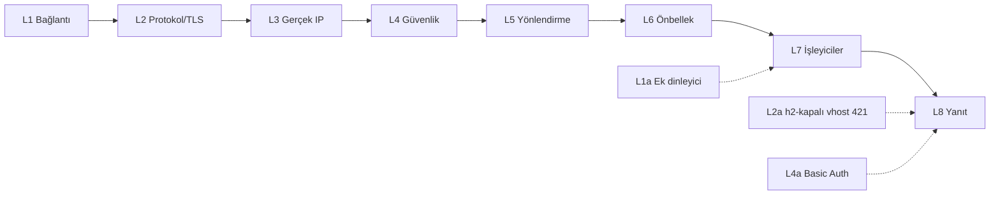

# ZMax Web Trafik Boru Hattı — 8 Katman (+3 alt parça), kodla eşlenmiş

Kök: `D:\zmaxserver\katmanlizmax\doc\agaclar\birlesme2\crates\zmax-bin\src` (`main` = `birlesme2` = `dff16c6`). Satırlar bu sürüme aittir.

## 1. Gerçek yürütme sırası
Yaprak işlevler `pipeline/l1…l8` altına taşındı (M5–M8); **sıralamayı yapan orkestratörler** `web_engine/pipeline_h1.rs::handle_single_web_request` (32) ve `web_engine/pipeline_h2.rs::handle_h2_dispatched_request` (23) dosyalarında kaldı. `Outcome`/`RequestContext`/`PipelineLayer` sözleşmesi (v3.0 planı) **kodda yazılmadı** — hedef olarak aşağıda §3'te duruyor.

HTTP/1.1 sırası (`pipeline_h1.rs`): vhost çözümü 51 → gerçek IP 53 → bilinmeyen Host 403 (68) → `evaluate_request_security` 108 (ban, ACL, WAF, WP brute-force, **force_https yönlendirmesi**; rate limit ayrıca 132) → Basic Auth 309 → ters vekil 359 → PURGE 390 → ACME muafiyeti/rewrite/.htaccess 431-449 → önbellek 607+ → PHP/statik.
HTTP/2 sırası (`pipeline_h2.rs`): vhost 38-52 → gerçek IP 54 → **h2-kapalı vhost 421 (84)** → güvenlik 96/108 → Basic Auth 188 → PURGE 215 → ters vekil 228 → rewrite 257 → FastCGI 342 → statik 430.

---

## 2. Katmanlar

### L1 — Bağlantı (`pipeline/l1_connection.rs`)
- **Görev:** TCP kabulü, bağlantı başına zaman aşımları.
- **Kod:** `spawn_http_accept_loop` 14, `spawn_https_accept_loop` 36, `handle_web_connection` 72 (header/body/idle zaman aşımı: `with_idle_timeout` 113-119, `header_timeout`/`body_timeout` 134-135; `slowloris_*` ayarları 97-98). Dinleyici kurma `core/boot.rs` (`create_reuse_listener` 111; HTTP kabul 445, HTTPS 464).
- **Yok:** IP başına eşzamanlı bağlantı sınırı kodda bulunamadı (`04` §5, Yok).

### L1a — Ek dinleyici (alt parça, M21) (`web_engine/extra_listeners.rs`)
- **Görev:** `[[listeners.extra]]` (yapılandırma `zmax-config/src/extra_listener.rs:39 ExtraListenerConfig`; doğrulama `validate_extra_listeners` 180): keyfi portta, kendi TLS sertifikasıyla dinler, her isteği **yapılandırmadaki sabit arka uca** (Host'tan türetilmez) ters vekil eder; yol öneki (`select_upstream` 238, en uzun önek) ile birden çok arka uç.
- **Kod:** `reconcile` 167 (ekler/çıkarır/ayar ve sertifikayı canlı günceller; hata reload'u bozmaz), `start_one` 82, `cert_source` 50, `probe_cert` 60, `handle_conn` 312, `handle_request` 368. Çağrı: `core/boot.rs:608` (açılış), `config/reload.rs:159` (SIGHUP/`POST /api/v1/reload`); dışa açılış `web_engine/mod.rs:14`.
- **Güvenlik/akış:** yasaklı IP + global ACL + hız sınırı çekirdekle aynı bileşenler; gerçek IP `zmax_httpparser::resolve_real_ip` ile (L3 sarmalayıcısını kullanmaz, `extra_listeners.rs:22,398`); iletim `proxy_h1::serve_proxy_request` (L7 `proxy.rs`); H2 yok (`tls_http2: false`, 303); vhost WAF/rewrite/önbellek yoktur — sentetik `ResolvedVHostContext` kurulur (`synthetic_ctx` 251).
- **Not:** L1'in kabul kodunu paylaşmaz; ayrı döngüdür.

### L2 — Protokol ve TLS (`pipeline/l2_protocol.rs`, `pipeline/l2_protocol/h2.rs`)
- **Görev:** TLS/ALPN, HTTP/1.1 ayrıştırma (`zmax-httpparser`), HTTP/2.
- **Kod:** `h2.rs::handle_h2_connection` 21, `process_h2_stream` 115, `stream_body_to_h2` 434; HTTP/1 ayrıştırma `zmax-httpparser` + `handle_web_connection` 72. Strict SNI yapılandırması `zmax-config/src/lib.rs:167` (`strict_sni`). Bilinmeyen Host → 403 `pipeline_h1.rs:68`.
- **Not:** `Host` yok/çift reddi `zmax-httpparser` içinde (test: `test_smuggling_duplicate_or_empty_host_and_control_chars_rejected`, `zmax-httpparser/src/lib.rs:1651`).

### L2a — h2'ye kapalı vhost denetimi (alt parça, M21)
- **Görev:** vhost `tls.http2 = false` ise o alan adına gelen HTTP/2 isteği 421 Misdirected Request ile reddedilir (HTTP/1.1 yolu etkilenmez).
- **Kod:** `web_engine/pipeline_h2.rs:84-94` (`if is_https && !vhost_ctx.tls_http2` → 421, gövde "HTTP/2 is disabled for this domain"); bayrak `pipeline/l5_router.rs:66` (alan), `438` (vhost'tan `vh.entry.tls.http2`), `508` (bilinmeyen host varsayılanı `true`).
- **Sıra:** h2'de vhost çözümü ve gerçek IP'den sonra, güvenlik hattından **önce**.

### L3 — Gerçek IP (`pipeline/l3_realip.rs`)
- **Görev:** `X-Forwarded-For` vb. başlıktan istemci IP'si; `RealIpPolicy` (`modules/policy.rs:8`: `enabled`, `header_name`, `trusted_proxies`, `recursive`); modül kapalıysa `peer_ip` döner.
- **Kod:** `resolve_real_ip` 7 (sarmalayıcı); çağrılar `web_engine/pipeline_h1.rs:53`, `pipeline_h2.rs:54`; API tarafı `zmax_httpparser::resolve_real_ip` doğrudan (`api/mod.rs:193,221`, `api/admin_static.rs:38`), L1a da doğrudan (`extra_listeners.rs:398`). Eski iki kopya tek işleve inmiştir (HTTP/1+h2).

### L4 — Güvenlik (`pipeline/l4_security.rs`)
- **Görev:** saldırı kararı.
- **Kod:** `evaluate_request_security` 48 → `SecurityVerdict` 36 (`Allowed`, `RedirectHttps`, `Blocked`, `WafBlocked`); sırayla ban, CIDR ACL (`build_merged_vhost_acl` 10), vhost WAF, gizli dosya/path traversal, WP brute-force (113), force_https; `record_waf_block` 133. **IP rate limit bu işlevde değildir:** `state.limiter.check_allowed` yalnız HTTP/1 orkestratöründe (`pipeline_h1.rs:132-133`) ve L1a'da (`extra_listeners.rs:487`) çağrılır; `pipeline_h2.rs` içinde **bulunamadı** (HTTP/2 yolunda IP rate limit yok). `security_pipeline.rs` bunları yeniden dışa aktarır (`security_pipeline.rs:5-7`).
- **Dikkat:** `force_https` 301 kararı (`https_redirect_location`, `l5_router.rs:93`) kodda **L4'ün `RedirectHttps` sonucu** olarak döner; ACME muaf (`is_acme_challenge`, `l5_router.rs:86`).
- **Redis:** WP brute-force sonrası ban yayını `pipeline_h1.rs:183-190` (`crate::redis::ban_settings` + `publish_ban`; süre `banned_ip_ttl_seconds`).
- **Muafiyet:** loopback ve `allow_ips` rate limit'ten muaf; WAF'tan muaf değil.

### L4a — Basic Auth (alt parça, M21)
- **Görev:** vhost `auth` bölümü (`zmax-config/src/auth.rs:15 VHostAuthSection`) açıksa `Authorization: Basic` denetimi; hatalı denemeler IP bazında sayılır, eşik aşımında IP banlanır; ACME HTTP-01 yolu muaf (`is_acme_challenge_exempt`).
- **Kod:** `security_pipeline.rs` — `evaluate_basic_auth` 15 (asenkron, hash `spawn_blocking`+`Semaphore`), `build_unauthorized_response` 45 (`WWW-Authenticate: Basic realm`), `AuthDenial` 89, `build_auth_denial` 98. Motor: `zmax-security/src/basic_auth.rs` (`BasicAuthManager` 1651, `$apr1$` `verify_apr1` 368, Argon2id `verify_argon2id` 893, `verify_password` 958). Durum: `ServerState.basic_auth` (`core/state.rs`). Çağrı: `pipeline_h1.rs:309-322`, `pipeline_h2.rs:188-190`.
- **Sıra:** güvenlik hattından sonra, ters vekil/rewrite'tan önce.

### L5 — Yönlendirme (`pipeline/l5_router.rs`)
- **Kod:** `resolve_vhost_context` 335 (`ResolvedVHostContext` 25; `VhostProto` 328), `proxy_route_matches` 524, hotlink (`is_hotlink_blocked` 273, `is_request_hotlink_blocked` 302), `is_acme_challenge` 86, `https_redirect_location` 93. Rewrite/`.htaccess`: orkestratörde (`pipeline_h1.rs:431`, `pipeline_h2.rs:257`) + `zmax-rewrite`.
- **Not:** kod proxy kararını rewrite'tan **önce** verir (`pipeline_h1.rs:359` → 431; `pipeline_h2.rs:228` → 257).

### L6 — Önbellek (`pipeline/l6_cache.rs`)
- **Kod:** `request_has_bypass_cookie_or_auth` 52, `response_forbids_cache` 93, `write_cached_php_response` 123, `write_cached_static_response` 160, `authorize_purge` 217, `process_cache_purge_request` 248, `purge_response_parts` 294, `append_domain_and_uri_cache_tags` 14. Anahtar/SWR/stampede: orkestratörde `build_cache_key` + `state.cache.get_with_stale` (`pipeline_h1.rs:607-618`), `StampedeSlot`.

### L7 — İşleyiciler (`pipeline/l7_handlers/`)
1. `fastcgi.rs` (401): `execute_and_prepare_php` 32, `fetch_and_cache_php` 241, `serve_php_request` 282.
2. `static_files.rs` (808): `serve_static_file` 314, `revalidate_static_cache` 685, görsel müzakere (`select_negotiated_image_path` 84), `try_stream_tcp_sendfile` 169, `stream_file_range_pooled` 224, kök sınırı `canonicalize` (113, 291-292).
3. `proxy.rs` (646): `serve_proxy_request` 73 (HTTP/1+WebSocket), `serve_h2_proxy_request` 418.
4. `upstream.rs` (30): `BackendSemaphores` 12 (`get_or_create` 24). Havuz `ServerState.upstream_pool` (`zmax-pool`).

### L8 — Yanıt (`pipeline/l8_response.rs`)
- **Kod:** `resolve_vhost_security_headers` 21, `compress_dynamic_content` 52, `format_http_response_head` 78, `write_http_response` 163, `write_error_response` 259, `default_status_reason` 231, `record_and_log` 347, `record_and_log_vhost` 412. Eski ad uyumluluğu: `http_write`, `logging`, `headers` modülleri (487-500).
- **Not:** gerçekte orkestratörler (`pipeline_h1/h2`) de bu yazma işlevlerini doğrudan çağırır.

---

## 3. Hedef sözleşme (HENÜZ KODDA YOK)
`Outcome { Continue(RequestContext), Respond(ResponseContext) }` ve katman imzası `async fn run(ctx, st) -> Outcome` v3.0'da öngörüldü; taşıma "davranış değişmez" kuralıyla yapıldığından yazılmadı. Yazılacaksa ayrı kart ve sahip onayı gerekir.
