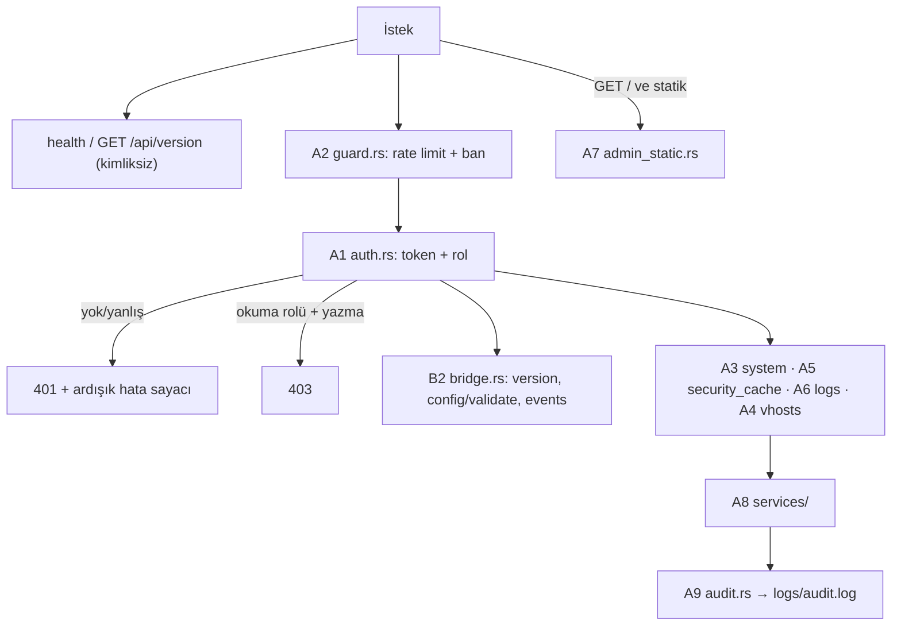

# ZMax Yönetim API'si — 9 Modül, kodla eşlenmiş

Kök: `D:\zmaxserver\katmanlizmax\doc\agaclar\birlesme2\crates\zmax-bin\src\api` (`main` = `birlesme2` = `dff16c6`). `api.rs` silinmiştir; tüm iş bu klasöre taşındı (M3, M4, M13–M18, M20).

## 1. Dinleyiciler ve erişim kanalları
| Kanal | Kod | Kullanan | Not |
|---|---|---|---|
| Port 19485 (`listeners.admin`) | `api/admin_static.rs::handle_admin_connection` 7 (dinleyici `core/boot.rs` ~522-540) | WebAdmin tarayıcı | Statik arayüz + API'ye vekil (`proxy_prefix`); `handle_api_route(..., false, local)` (`admin_static.rs:67`) |
| Port 19486 (`listeners.api`) | `api/mod.rs::handle_api_connection` 163 (dinleyici `core/boot.rs` ~583-600) | zPanel, CLI | Yalnız API; `handle_api_route(..., true, local)` (`mod.rs:222`) |
| Unix soketi (`unix_socket`) | `core/boot.rs:620` (`UnixListener::bind`) | Yerel CLI / zPanel | Ağ dışı kanal |
Üçü de `handle_api_route` (`api/mod.rs:54`) içinden geçer. `local` = bağlanan eş **ve** çözülmüş gerçek IP loopback (`mod.rs:200`, `admin_static.rs:45`).

## 2. İstek akışı (gerçek sıra, `api/mod.rs:54-155`)
`proxy_prefix` normalizasyonu (89) → `/api/`/`/metrics` değilse (admin'de) statik'e bırak → CORS OPTIONS (95) → **`health`/`GET /api/version` (111, kimliksiz)** → **A2 `api_koruma_engelle` (116)** → **A1 `authorize_role` (121)**: `None` → `kaydet_basarisiz` + 401 (123), okuma rolü + yazma ucu → 403 (128) → B2 `bridge::handle` (136) → A3 `system` → A5 `security_cache` → A6 `logs` → A4 `vhosts` → eşleşmeyen 404.
Hata biçimi **tek tip değildir**: bazı uçlar `{"ok":false,"error":"…"}` (Türkçe/ASCII karışık), köprü doğrulama ucu `{"valid":false,"message":…}` döner.

---

## 3. Modüller

### A1 — Kimlik ve yetki (`api/auth.rs`, 232 satır) — **Var**
- `constant_time_eq` 8, `AuthRole {Admin, Read}` 20, `authorize_role` 27, `is_authorized` 62, `read_role_allowed` 72, `generate_secure_token` 85 (OS CSPRNG), `compute_effective_auth` 112 (hot-reload'da token korunur; test `test_compute_effective_auth_preserves_tokens_and_auto_generates`).
- **İki rol:** yönetim token'ı (`api_token`/`admin_token`) → `Admin`; `read_token` (`zmax-config/src/lib.rs:194,230`; admin boşsa api'ninkine düşer) → `Read`; `Read` yalnız GET/HEAD ve `status, metrics, health, logs, vhosts, ports, config, version` (`auth.rs:72-83`).
- **Boş token kapısı kapalı:** `authorize_role` 27-35 — token boşsa yalnız `local && !require_token` geçer, aksi `None` (401).
- Başlıklar: `Authorization: Bearer` ve `X-ZMax-Token`.

### A2 — Koruma zinciri (`api/guard.rs`, 146 satır) — **Var**
- **API rate limit:** `api_koruma_engelle` 28: yalnız loopback olmayan istemci IP'si (`ISTEMCI_IP` task-local, `guard.rs:8`); önce ban (`ban_manager.is_banned`) → 403, sonra `zmax_security::RateLimiter` → 429 (`Retry-After 60`). Ayar: `security.api_rate_limit_per_minute` (varsayılan 120, `zmax-config/src/lib.rs:381`; 0 = kapalı).
- **Ardışık 401 banı:** `kaydet_basarisiz` 55: pencere içinde (`auth_fail_window_sec` 300) `auth_fail_limit` (5) başarısızlıkta IP `auth_ban_sec` (900) banlanır ve Redis'e yayınlanır (`redis::publish_ban`).
- Girdi yardımcıları: `percent_decode_component` 77, `parse_query_param` 108, `normalize_panel_request_path` 129. `has_parent_dir_traversal` `zmax-config/src/vhost_json.rs:152`'dedir (A2'de değil). Boyut/okuma limitleri `api/http.rs::read_http_request_with_limits` 159. CORS `api/mod.rs:95-108`.
- **Not:** `guard::ISTEMCI_IP.scope(...)` ile istemci IP'si verilmeyen çağrılarda (testler) koruma atlanır.

### A3 — Sistem (`api/routes/system.rs`, 369 satır) — **Var**
`GET /api/v1/health` 14 (+`contract_version`, `generation`), `GET /api/version` 37 (**eski yol, kimliksiz**), `GET /metrics` ve `/api/v1/metrics` 55, `GET /api/v1/status` 121, `GET /api/v1/modules` 198, `POST /api/v1/modules/toggle` 239, `GET /api/v1/ports` 298. `reload` ve `config` `services/config_service.rs`'te. **Karar 9 notu:** `health` loopback denetimi olmadan, auth'tan önce çalışır (dış ağdan kimliksiz); `metrics` auth'tan sonra (`okuma` yeter).

### A4 — VHost (`api/routes/vhosts.rs`, 176 satır) — **Var**
`GET /api/v1/vhosts` 13, `POST /api/v1/vhosts` ve `PUT|POST /api/v1/vhosts/:domain` 26-101, `DELETE /api/v1/vhosts/:domain` 102. İş mantığı `services/vhost_service.rs`: `format_vhost_json` 3, `write_vhost_atomic_with_rollback` 7, `rollback_vhost_file` 83, `merge_vhost_json_patch` 94. **`.lock` dosyası yok** (Karar 5 Rust tarafı).

### A5 — Güvenlik ve önbellek (`api/routes/security_cache.rs` → `services/`) — **Var**
`GET /api/v1/security/bans`, `POST /api/v1/security/unban` (`security_service.rs` 16, 61; `classify_ban_reason_key` 3), `POST /api/v1/cache/purge` (`cache_service.rs:13`; kapsamlar domain/tag/domain_tag/çoklu). Eski `/api/purge` yolu kaldırıldı. Ban **ekleme** ucu yoktur (yalnız liste + unban).

### A6 — Loglar (`api/routes/logs.rs`, 324 satır) — **Var**
`GET /api/v1/logs` 121, `POST /api/v1/logs/reopen` 286, **`GET /api/v1/logs/stream` (SSE) 29-110**: `AsyncLogManager::subscribe_live` (`logger/mod.rs:157`) kaynaklı, `domain`/`type` süzgeci, eşzamanlı akış üst sınırı 20 (`MAX_LOG_STREAMS` 6).

### A7 — WebAdmin statik sunumu (`api/admin_static.rs`, 137 satır) — **Var**
`handle_admin_connection` 7; `admin/` kökünden okur, kök dışına çıkış engelli; API verisi içermez.

### A8 — Servisler (`api/services/`) — **Var**
`vhost_service.rs` (101), `cache_service.rs` (194), `security_service.rs` (103), `config_service.rs` (102: `reload` 3, `config` 45). `reload` yanıtı `{ok, status, generation, vhosts_loaded, errors}` (başarısızlıkta 500 + `errors:[…]`; hangi dosya reddedildi alanı yok). Servisler hâlâ `socket`/`ParsedHttpRequest` alır — "HTTP bilmez" kuralı **uygulanmadı** (taşıma davranış değiştirmeden yapıldı).

### A9 — Denetim kaydı (`api/audit.rs`, 58 satır) — **Var**
`satir` 40, `kayit` 54 → `logs/audit.log` (rotasyonlu ekleme). Çağrı noktaları: `modul-ac|kapat|degistir` (`system.rs:257,278`), `vhost-kaydet|sil` (`vhosts.rs:84-146`), `cache-purge` (`cache_service.rs:68`), `reload` (`config_service.rs:16,28`), `unban` (`security_service.rs:83`). Token/gizli değer yazılmaz (`temiz` 9). Kanal sabit `"api"`; `rol` alanı `satir` işlevinde var, çağrılar rol geçirmez.

---

## 3b. Köprü uç noktaları (B2) — `api/bridge.rs` (112 satır) — **Var**
`CONTRACT_VERSION = "1.0"` (7); `GET /api/v1/version` 46 (`server_version`, `contract_version`, `supported_features`), `POST /api/v1/config/validate` 58 (`valid`, `message`, `error_field`, `error_line`), `GET /api/v1/events` 89 (SSE, 15 sn ping; yayın `bridge::emit` 18). Yayılan olaylar: `vhost_applied` (`config/reload.rs:162`), `config_rejected` (`config_service.rs:29`), `ban_removed` (`security_service.rs:91`). **Yayınlanmayan:** `ban_added`, `cert_renewed` (planlanmıştı). `reload` yanıtında `generation` var; `health` yanıtında `contract_version` ve `generation` var.

## 4. Sürümleme
Rotalar `/api/v1/...`; kalan eski yol `GET /api/version` (kimliksiz) ve `read_role_allowed`'ın `/api` öneki soyması (`auth.rs:77`). Karar 4 bu iki noktada tamamlanmadı.
