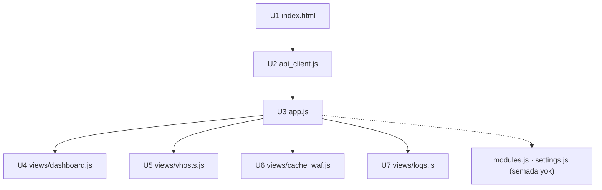

# ZMax WebAdmin Arayüzü — 7 Bileşen, kodla eşlenmiş

Kök: `D:\zmaxserver\katmanlizmax\doc\agaclar\birlesme2\admin` (`main` = `birlesme2` = `dff16c6`). WebAdmin (Port 19485) **Vue 3** (`js/vue.global.prod.js`) ile yazılmıştır. M10 (`[m10] WebAdmin Vue 3 U1-U7`) `core.js`'i bölmüştür; `core.js` artık yoktur.

## 1. Gerçek dosyalar (satır sayıları `wc -l`)
- `index.html` 372 (v3.0 planında 885) — betikler 360-370: vue, bootstrap, `i18n.js`, `api_client.js`, `views/{dashboard,vhosts,cache_waf,modules,logs,settings}.js`, `app.js`.
- `js/api_client.js` 263, `js/app.js` 510, `js/i18n.js` 1136, `js/views/`: `dashboard.js` 297, `vhosts.js` 347, `cache_waf.js` 236, `logs.js` 217, `modules.js` 79, `settings.js` 38.
- `css/`: `core.css` 1122, `admin.css` 684, `bootstrap.min.css`; `assets/`: `zmax_white.svg`, `zmax_black.svg`, `zpanel_icon.svg`; `favicon.svg`.

## 2. Bileşenler

### U1 — İskelet (`admin/index.html`, 372 satır) — **Var**
HTML5 iskeleti, topbar/sidebar, `#app`, token giriş modalı, TR/EN seçici, tema düğmesi. Ekran şablonları artık görünüm dosyalarındadır (her `views/*.js` kendi `template` değerini taşır).

### U2 — API istemcisi (`js/api_client.js`, 263 satır) — **Var (bir hata ile)**
`window.ZMaxApiClient`: token `localStorage` (`:11,49-58`); `?token=` okunup `history.replaceState` ile adres çubuğundan silinir (`:43`); `fetch` 75 her isteğe `X-ZMax-Token` + `Authorization: Bearer` ekler (80-81), 401'de (`:88`) `setUnauthorizedHandler` ile token modalını açar (`app.js:166`); `validateToken` (`app.js:138`); `reopenLogs` 218; `createLogsStream` 223 (SSE).
**Bilinen sorun (koddan):** `createLogsStream` token'ı `EventSource` için **URL sorgusuna** koyar (`?token=`, satır 225); sunucu (`api/auth.rs::authorize_role`) yalnız başlıkları okur, sorgu parametresini **okumaz** → token tanımlıysa canlı log akışı 401 alır, ayrıca "token URL'ye yazılmaz" kuralıyla çelişir. Düzeltme ayrı karttır (bu belge yalnız durumu yazar).

### U3 — Uygulama kökü (`js/app.js`, 510 satır) — **Var**
Vue kökü, ekran geçişi, tema/dil, token modalı akışı (114-166). `i18n.js` tek sözlük (`window.ZMaxI18n`, varsayılan Türkçe).

### U4 — Dashboard (`js/views/dashboard.js`, 297) — **Var**
`GET /api/v1/status` verisinden istek hızı, bellek, bağlantı/FD, çalışma süresi, hizmet durumları.

### U5 — VHost (`js/views/vhosts.js`, 347) — **Var**
`/api/v1/vhosts` GET/POST/PUT/DELETE ile liste, arama, SSL durumu, düzenleme modalı.

### U6 — Önbellek ve WAF (`js/views/cache_waf.js`, 236) — **Var**
`/api/v1/cache/purge`, `/api/v1/security/bans`, `/api/v1/security/unban`.

### U7 — Loglar (`js/views/logs.js`, 217) — **Var (SSE yukarıdaki sorunla)**
`GET /api/v1/logs` son satırlar; SSE canlı akış `createLogsStream` ile; duraklat/devam, arama, temizle.

### Şemada olmayan görünümler (koda göre)
- `js/views/modules.js` (79): sunucu modülleri **listeleme/kategori filtresi** ekranı. Modül **anahtarı (aç/kapa)** kontrolü yok; API ucu (`POST /api/v1/modules/toggle`) hazır. Karar 3 ("modül anahtarı ekranı planlanmadı") ile uyumlu; liste ekranı ise v3.0 planında yoktu.
- `js/views/settings.js` (38): yapılandırma/ayarlar görünümü (dinleyici portları, mimalloc, fastcgi, toml bilgisi).

## 3. i18n ve kurallar
`i18n.js` anahtar tabanlı sözlük; tüm metin Türkçe karakterle (ASCII yedek yok). Arayüz yalnız API'den veri alır (`api_client.js` dışında `fetch` yok). Yeni ekran eklemeden önce bu belgeye satır eklenir.
