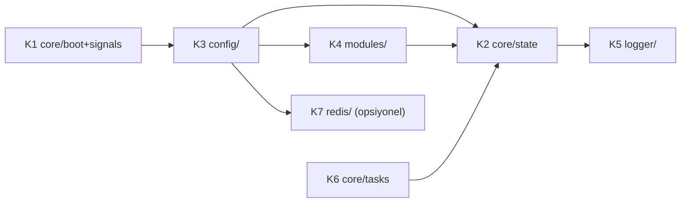

# ZMax Çekirdek ve Kontrol Düzlemi — 7 Parça (K1-K7), kodla eşlenmiş

Kök: `D:\zmaxserver\katmanlizmax\doc\agaclar\birlesme2\crates\zmax-bin\src` (`main` = `birlesme2` = `dff16c6`). `main.rs`: `main()` 45 + gömülü testler (50-2873); `modules_runtime.rs` yalnız testler; `logger.rs`, `api.rs` silindi.

## K1 — Boot ve sinyaller (`core/boot.rs` 873, `core/signals.rs` 55) — **Var, kısmi kopya**
- **`boot.rs`:** `CliOptions` 22, `parse_cli_args` 29, `resolve_base_dir` 69, `create_reuse_listener` 111, `collect_tls_key_paths` 144, `run_fix_tls_perms` 182, `parse_bind_addr` 216, `run` 228. `run` içinde: HTTP kabul döngüsü 445, HTTPS 464, admin 522-540 (`handle_admin_connection`), API 583-600 (`handle_api_connection`), ek dinleyiciler 608 (`reconcile_extra_listeners`, **L1a**), Unix soketi 620, SIGHUP 825+, SIGUSR1 850+ (`reopen_all`, 859).
- **`signals.rs`:** `spawn_signal_handlers` 6 (SIGHUP → `reload_runtime_state`, SIGUSR1 → log yeniden aç). **Hiçbir yerden çağrılmıyor** (kullanımı arandı: yalnız tanım); aynı mantık `boot.rs` içinde satır içi yazılı → kopya.
- `main.rs::main` 45 `core::boot::run()` çağırır.

## K2 — Durum (`core/state.rs`, 131 satır) — **Var**
`AccessLogRecord` 17, `ServerStats` 29, `RuntimeState` 36 (`config`, `vhosts`, `modules`, `policies`, `redis_client`, `auth`, yollar), `CONFIG_GENERATION` 49 (köprü `generation`), `ServerState` 51 (`cache`, `limiter`, `ban_manager`, `wp_guard`, `basic_auth`, `upstream_pool`, `runtime: RwLock`, `tls/admin_tls/api_tls`, `log_manager`, `waf_events`, `htaccess_resolver`, `shutdown`, `access_logs`, `stats`), `record_access_log` 75, `current_hms_utc` 121.
**Kural durumu:** L ve A birbirini içe aktarmaz — denetim `tools/tasima_kontrol.py yon` (birlesme2'de GEÇTİ). Gerçekte `web_engine/pipeline_h1.rs` hem `crate::redis` hem `crate::api` kullanır.

## K3 — Yapılandırma (`config/`) — **Var**
- `config/reload.rs` (175): `refresh_tls_certs` 11, `current_https_alpn_protocols` 27, `refresh_listener_tls_cert` 32, `reload_runtime_state_with_alpn` 66, `reload_runtime_state` 171. Akış: yükle → **doğrula** (`validate_workspace_layout?` 86, hatalıysa eski kalır) → hesapla (Redis istemcisi, `compute_effective_auth`) → **uygula** (`rt` yazma kilidi, takas 148-155) → ek dinleyici uzlaştır (159) → `CONFIG_GENERATION` artır + `vhost_applied` yayını (161-166). Ayrı "geri al" adımı yok: doğrulama takastan önce olduğundan başarısızlıkta durum değişmez.
- `config/acme.rs` (101): `apply_global_acme_root` 21, `resolve_vhost_acme_root` 32. `acme_runtime.rs` (2 satır) yeniden dışa aktarım.
- `api.rs` yerine `api::reload_runtime_state` dışa aktarımı korunur. Ayrıştırma `zmax-config` crate'indedir (yeni: `auth.rs`, `extra_listener.rs`, `vhost_json.rs`).

## K4 — Modüller (`modules/`) — **Var**
`modules/policy.rs` (356): `RealIpPolicy` 8, `GzipPolicy` 27, `WafPolicy` 55, `ProxyModulePolicy` 72, `FastCgiModulePolicy` 91, `StaticModulePolicy` 114, `CompiledPolicies` 136, `compile_policies` 152; `modules/registry.rs` (35): `module_category_key` 4. Modül dosyaları: kök `modules/mod_*.toml`, **18 adet** (acme, autoindex, brotli, cache, coreruleset, fastcgi, geoip, gzip, headers, pagespeed, proxy, quic, realip, redis, rewrite, security, ssl, static — dizin listesinden sayıldı).

## K5 — Logger (`logger/`) — **Var**
`mod.rs` (273): `AsyncLogManager` 87, `new` 98, `subscribe_live` 157 (SSE kaynağı, A6), `log_access` 172, `log_error` 179, `log_waf_event` 206, `reopen_all` 237, `flush` 245, `update_global_paths` 253; `worker.rs` (344, tek işçi, `ensure_ready_and_write` 126); `format.rs` (110: `format_combined_line` 62, `format_json_line` 86, `sanitize_log_line` 5, `escape_clf_quoted` 40); `rotate.rs` (72: `append_line_with_rotation` 19 — audit.log de bunu kullanır); `tail.rs` (86: `read_tail_lines` 7); `tests.rs` (465). Düşen kayıt sayacı `dropped_events` 201.

## K6 — Arka plan görevleri (`core/tasks.rs`, 18 satır) — **Kısmi**
`spawn_background_tasks` 6: 60 sn'de bir `upstream_pool.purge_expired`, `limiter.purge_expired`, `ban_manager.list_banned`. **Çağrılmıyor**; aynı döngü `boot.rs:425-440` içinde satır içi. TLS sertifika yenilemesi periyodik görev değildir: açılışta (`boot.rs:451`) ve reload'da (`config/reload.rs`). Kural ("her görevin sahibi/iptal sinyali olsun") yalnız Redis aboneliğinde `state.shutdown` ile uygulanır; diğer `tokio::spawn`'ların sahipliği yazılmadı. **K7 aboneliği K6 altında değil**, doğrudan `boot.rs:440`'tan başlatılır.

## K7 — Dağıtık durum / Redis (`redis/`) — **Var (M19)**
Redis opsiyoneldir (`RuntimeState.redis_client: Option`, modül kapalıysa `None`).

| Parça | Yer | Durum |
|---|---|---|
| İstemci kurulumu (`mod_redis` açıksa), reload'da yenilenir | `redis/client.rs` `build_redis_client` 5; `config/reload.rs:88` | Var |
| Ban ayarları: `banned_ip_sync` (varsayılan true), `banned_ip_ttl_seconds` (kodda varsayılan 900; `mod_redis.toml` 86400) | `redis/sync.rs:19` `ban_settings` | Var |
| Yayın: `publish_ban` 41, `publish_unban` 57, `publish_reload` 64, `publish_purge_tag(s)`/`_raw_tag(s)`/`_domain`/`_domain_uri`/`_uri`/`_all` 71-191; her yayın `tokio::spawn` + **250 ms** zaman aşımı (`spawn_event` 29), istek yolu beklemez | `redis/sync.rs` | Var |
| WP brute-force banı yayını (süre = `banned_ip_ttl_seconds`) | `web_engine/pipeline_h1.rs:183-190` | Var |
| API ardışık-401 banı yayını | `api/guard.rs:55-75` | Var |
| `UnbanIp` yayını | `api/services/security_service.rs:86-87` (`ban_sync` açıksa) | Var |
| `ReloadConfig` yayını | `api/services/config_service.rs:19` | Var |
| Purge yayını | `api/services/cache_service.rs` | Var |
| **Abone:** `spawn_subscriber` `redis/events.rs:52`, boot'ta `core/boot.rs:440`; kendi olayını yok sayar (`is_own_event` 9, `node_id` `sync.rs:7`); `apply_event` 13: `BanIp`/`UnbanIp` (`ban_sync` açıksa), `PurgeDomain/Tag/All`, `ReloadConfig` (`reload_runtime_state` + önbellek temizle); Redis istemcisi yoksa 30 sn'de bir yeniden bakar; yapılandırma anahtarı değişince yeniden bağlanır (30 sn denetim); yeniden bağlanma bekleme ayarı `reconnect_backoff_ms` (`client.rs:46`, varsayılan 500) | `redis/events.rs` | Var |
| Kodsuz ayarlar (`object_cache_bridge`, `session_storage`, `shared_ip_rate_limiting`) | `modules/mod_redis.toml` içinde yok (arandı: boş) | Temizlendi |
| Olay türleri (6): `BanIp`, `UnbanIp`, `PurgeDomain`, `PurgeTag`, `PurgeAll`, `ReloadConfig` + `node_id` taşıyan `publish_event_from` | `zmax-redis/src/lib.rs:138…` | Var |

**Kalan boşluklar:** (1) `RedisConfig` `derive(Debug)` ile parolayı maskelemez (`zmax-redis/src/lib.rs:46`); (2) abone JoinHandle'ı dışarıda tutulmaz (K6 sahipliği yok); (3) **Doğrulanmadı:** `publish_purge_raw_tag(s)` düz `tag:<etiket>` iletisi yayınlar (`sync.rs:114-118`, `redis.publish_purge`); abonenin bunu `ClusterSyncEvent`'e çözüp çözmediği (`zmax-redis` ayrıştırıcısı) okunmadı.
