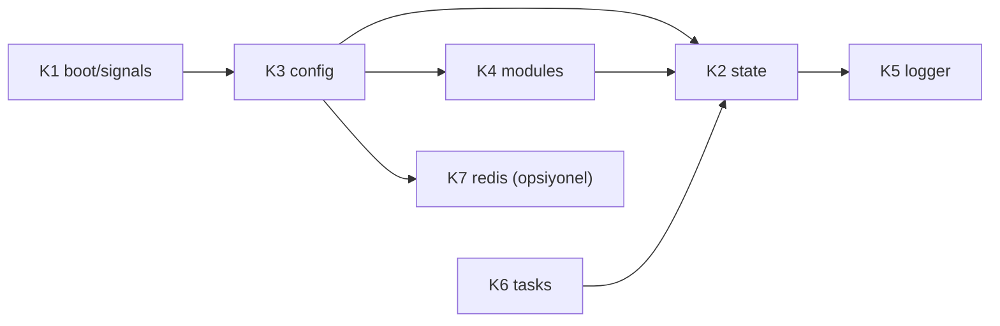

# ZMax Çekirdek ve Kontrol Düzlemi — 7 Parça (K1-K7)

Boru hattı (L1-L8) trafiği taşır; bu bölüm onu ayağa kaldıran, yapılandıran ve izleyen parçalardır. v2.0'da şemada hiç yoktu, ama `main.rs` (2142), `modules_runtime.rs` (1437), `logger.rs` (1139) ve `api.rs`'in ilk 570 satırı bunlardan oluşuyor.

## K1 — Boot ve Sinyaller (`core/boot.rs`, `core/signals.rs`)
- **Görev:** CLI (`parse_cli_args`), taban dizin bulma (`resolve_base_dir`), dinleyici kurma (`create_reuse_listener`, `parse_bind_addr`), sinyal işleme, kapanış.
- **Sinyaller:** SIGHUP → reload (`main.rs:608`); SIGUSR1 (`user_defined1`, `main.rs:635`) işleyicisinin amacı taşıma sırasında doğrulanacak.
- **Koddaki yeri:** `main.rs` 1-165, 166-656 (parçalanır), `main()` yalnız `core::boot::run()` çağırır.

## K2 — Durum (`core/state.rs`)
- **Görev:** `ServerState`, `RuntimeState`, `ServerStats`, `AccessLogRecord`. Boru hattı ve API'nin **tek ortak noktası**; ikisi birbirini içe aktarmaz.
- **Kural:** salt okunur politikalar `Arc` ile paylaşılır (reload'da yeni `Arc` takılır, eski istekler eskiyle biter); sayaçlar atomik.
- **Koddaki yeri:** `api.rs` 27-120, `main.rs` 318-360 (durum kurulumu).

## K3 — Yapılandırma (`config/`)
- **Görev:** `zmax.toml` ve `conf/vhosts/*.toml` yükleme, doğrulama, `reload_runtime_state(_with_alpn)`, TLS sertifikası yenileme tetiği (`refresh_tls_certs`, `refresh_listener_tls_cert`).
- **Kural (yeni):** reload üç adımdır — **doğrula** (hatalıysa durdur, eski kalır), **uygula** (yeni `RuntimeState`'i tak), **geri al** (uygulama başarısızsa eskiyi geri koy). Token ve log yolları reload'da korunur.
- **Koddaki yeri:** `api.rs` 426-569, `zmax-config` crate'i (2991 satır, ayrıştırma orada kalır).

## K4 — Modüller (`modules/`)
- **Görev:** `modules/mod_*.toml` (18: acme, autoindex, brotli, cache, coreruleset, fastcgi, geoip, gzip, headers, pagespeed, proxy, quic, realip, redis, rewrite, security, ssl, static) dosyalarını `CompiledPolicies`'e çevirir (`compile_policies`).
- **Politikalar:** `RealIpPolicy`, `GzipPolicy`, `WafPolicy`, `ProxyModulePolicy`, `FastCgiModulePolicy`, `StaticModulePolicy`. Katmanlar bunları K2 üzerinden okur; modül kapalıysa ilgili katman adımını atlar.
- **Koddaki yeri:** `modules_runtime.rs` 11-361, 501-580.

## K5 — Logger (`logger/`)
- **Görev:** `AsyncLogManager` (tek işçi görev, kanal, düşen kayıt sayacı), NCSA Combined ve JSON biçimleri, vhost başına hedef, boyuta göre rotasyon, `reopen_all`, `read_tail_lines`.
- **Kural:** L8 ve API yalnız `log_access` / `log_error` çağırır; dosyaya doğrudan yazmaz. Canlı SSE akışı (A6) bu parçadan beslenir; denetim kaydı (A9) için ayrı hedef.
- **Koddaki yeri:** `logger.rs` tamamı; `modules_runtime.rs` 693-754 (eski satır-ekleme ve rotasyon fonksiyonları buraya birleşir).

## K6 — Arka Plan Görevleri (`core/tasks.rs`)
- **Görev:** bellek/havuz bakımı (`main.rs:361`), TLS sertifika yenileme, önbellek temizliği gibi zamanlanmış işler.
- **Kural:** her görevin sahibi, iptal sinyali ve zaman aşımı vardır; sahipsiz `tokio::spawn` yok.

## K7 — Dağıtık Durum / Redis (`redis/client.rs`, `redis/events.rs`, `redis/sync.rs`)
Redis, ZMax'in tek harici veri deposudur (vhost'lar dosyada, Redis bellek içi ortak durum). **Opsiyoneldir:** modül kapalıysa veya Redis erişilemezse ZMax tam çalışır (`RuntimeState.redis_client` bir `Option`).

**Koddan doğrulanan mevcut durum**
| Ne | Nerede |
|---|---|
| RESP2 istemcisi, `publish_event`, `subscribe_events`, `ban_ip`, `ping` | `zmax-redis` crate'i (1111 satır) |
| İstemci kurulumu (`mod_redis` açıksa), reload'da yenilenir | `modules_runtime.rs:535`, `api.rs:488`, `api.rs:1489` |
| Purge yayını: `PurgeTag`, `PurgeDomain`, `PurgeAll` | `api.rs:1830`, `api.rs:1996` (A5) |
| WP brute-force banı Redis'e yazılır (`ban_ip`, 900 sn, `tokio::spawn` + 200 ms zaman aşımı, istek yolunu bekletmez) | `web_engine.rs:1574` (L4) |
| Olay türleri: `BanIp`, `UnbanIp`, `PurgeDomain`, `PurgeTag`, `PurgeAll`, `ReloadConfig` | `zmax-redis/src/lib.rs:138` |

**Koddan çıkan boşluklar (doğrulandı: `zmax-bin` içinde grep sonucu yok)**
1. **Abone tarafı yok:** `subscribe_events` `zmax-bin` içinde hiç çağrılmıyor. Yayın var, alıcı yok; çok sunuculu temizleme ve ban senkronu bir yönlü.
2. `UnbanIp` ve `ReloadConfig` olayları hiçbir yerde yayınlanmıyor.
3. `mod_redis.toml` içindeki `object_cache_bridge`, `session_storage`, `shared_ip_rate_limiting`, `banned_ip_sync` ve `banned_ip_ttl_seconds` ayarlarının kodda karşılığı yok (yalnız `zmax-config` testi okuyor). Ban süresi kodda sabit 900 sn.

**Hedef kurallar**
- **İstek yolu Redis'i beklemez:** her Redis çağrısı `spawn` + zaman aşımı ile (L4'teki mevcut desen standarttır). Redis hatası isteği düşürmez, yalnız K5'e uyarı olarak yazılır.
- **Tek istemci:** Redis'e yalnız K7 dokunur; L4/A5 `redis/sync.rs` işlevlerini çağırır (`publish_ban`, `publish_purge`, `publish_unban`).
- **Olay sözleşmesi:** `ClusterSyncEvent` sürümlüdür; her olayda `node_id` taşınır, bir düğüm kendi olayını uygulamaz (döngü önleme).
- **Abone görevi (K6 altında çalışır):** gelen olay K2/L4/L6 üzerinden uygulanır (ban tablosu, önbellek temizleme, reload); bağlantı koparsa artan bekleme ile yeniden bağlanır.
- **Ayar–kod uyumu:** `mod_redis.toml` içinde yazılan her özelliğin kodu olmalı; kodu olmayan ayar dosyadan çıkarılır (karar: `00` §7 madde 8). Yapılmamış özellik için vaat metni yazılmaz.
- **Güvenlik:** şifre/TLS yapılandırmadan; şifre loga ve `Debug` çıktısına yazılmaz; yalnız `zmax:` önekli anahtarlar ve `zmax:cache:purge` kanalı kullanılır.

**Sıra notu:** K7, taşıma planında en sona bırakılmıştır (`06`); çünkü ZMax Redis'siz de çalışır.
