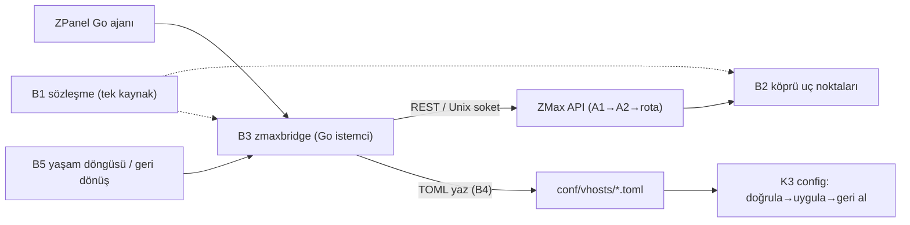

# ZMax ↔ ZPanel (Go) Köprüsü — 5 Parça (B1-B5)

## 1. Neden ayrı bir bölüm?
Bugün Go–Rust ilişkisi `D:\zmaxserver\doc\entegre\goentegre.md` içinde **yazılı bir sözleşme** olarak duruyor (TOML yaz → `POST /api/v1/reload` → ZMax doğrular), ama:
- Sözleşmenin **makine okunur bir tek kaynağı yok**; iki taraf da belgeyi okuyup elle uyguluyor.
- İki taraf aynı sözleşmeyi **birlikte test etmiyor**; TOML alanı veya JSON yanıtı bir tarafta değişince diğer taraf çalışma anında bozuluyor.
- Go tarafında paylaşılan bir istemci yok; her çağrı elle yazılmış HTTP (`goentegre.md` §5 örnekleri).
- `reload` yanıtı Go'ya "değişikliğim uygulandı mı?" sorusunu net cevaplamıyor.
- **İki yazar riski:** vhost TOML'unu hem Go (panel) hem Rust API'si (`write_vhost_atomic`, `PUT /api/v1/vhosts/:domain`) yazabiliyor.

Köprü, Rust'ın panel altında sağlıklı çalışması için bu boşlukları kapatır. Panel kaynağı (`D:\lunixpanel\zpanel-tam`, `zpanelv2`) çalışır durumdadır; **köprü ZMax deposunda yazılır, panele dokunmaz** (`goentegre.md` başlığındaki kural).

---

## 2. Parçalar

### B1 — Sözleşme (tek kaynak) (`bridge/contract/`)
- **İçerik:**
  - `openapi.yaml`: köprüde kullanılan uç noktalar ve JSON gövdeleri (A3-A5'in alt kümesi).
  - `vhost.schema.json`: vhost TOML alanlarının şeması (`conf/vhosts/example.com.toml` esas alınır).
  - `contract_version`: `MAJOR.MINOR`. MAJOR değişirse eski Go ajanı ZMax'i reddeder (B5).
  - `golden/`: örnek istek/yanıt dosyaları ve örnek TOML'lar.
- **Kural:** sözleşmeyi değiştiren iş önce burada yapılır; Rust ve Go testleri bu dosyalardan beslenir.
- **Sözleşme testi (iki tarafta aynı):** Rust, `golden/` içindeki her örneği ayrıştırır ve üretir; Go aynı dosyaları ayrıştırır. Biri bozulursa derleme sonrası test kırmızı olur.

### B2 — Rust tarafı köprü uç noktaları (`api/bridge.rs` → A8 servislerini çağırır)
Mevcut uç noktalara şu eklemeler gerekir (kodda **yok**, yeni yazılır):

| Uç nokta | Amaç |
|---|---|
| `GET /api/v1/version` | `server_version`, `contract_version`, desteklenen özellik listesi (Go uyumu burada denetler). |
| `POST /api/v1/config/validate` | TOML'u **uygulamadan** doğrular; hata satırı ve alan adı döner. Go yazmadan önce deneyebilir. |
| `POST /api/v1/reload` yanıtı | `{ "ok": true, "generation": 42, "vhosts_loaded": 120, "errors": [] }` — `generation`, her başarılı uygulamada artar; hata varsa `ok:false` ve **hangi dosyanın** reddedildiği. |
| `GET /api/v1/health` | `contract_version` ve `generation` da döner (hazırlık: "son reload bitti mi?"). |
| `GET /api/v1/events` (SSE) | `vhost_applied`, `ban_added`, `ban_removed`, `cert_renewed`, `config_rejected` olayları; Go iptables dinleyicisi ve telemetri bunu dinler (şu an Go dosya/poll ile okuyor). |

Kural: bu uç noktalar A1/A2 zincirinden geçer (token, rol). Köprü için ayrı rol yoktur; zPanel `yönetim` rolüyle kendi token'ını kullanır (karar: `00` §7 madde 7).

### B3 — Go istemci paketi (`bridge/go/zmaxbridge/`)
- **Görevi:** Go ajanın ZMax ile konuştuğu tek yol; ham `http.Post` çağrıları kalkar.
- **Özellikler:** kanal seçimi (Unix soket varsa o, yoksa `127.0.0.1:19486`), token yönetimi, her çağrıda zaman aşımı, sınırlı yeniden deneme + artan bekleme (yalnız güvenli/idempotent çağrılarda), devre kesici (ZMax erişilemezken panel donmaz), tipli hata (`ErrRejected{File,Field}`, `ErrUnavailable`, `ErrContractMismatch`).
- **Yüzey:** `Version()`, `Health()`, `Validate(toml)`, `Reload() (generation)`, `Status()`, `PurgeCache(scope)`, `Ban/Unban`, `Events(ctx)`.
- **Yeri:** ZMax deposunda ayrı Go modülü; panel yalnızca `import` eder (panel kodu bu depoda değişmez, karar: `00` §7 madde 6).
- **Test:** `golden/` ile sözleşme testi; sahte ZMax sunucusuyla zaman aşımı/devre kesici testleri.

### B4 — Dosya Sözleşmesi
- **Tek yazar kuralı:** vhost TOML'unu **yalnız bir taraf** yazar. Öneri: panel kaynağıdır; Go yazar, ZMax API'nin vhost yazma uç noktaları (`PUT/POST/DELETE /api/v1/vhosts/*`) yalnız WebAdmin/CLI içindir ve yazarken `.lock` dosyası alır. İki yazarın çakışması kesin yasaktır (karar: `00` §7 madde 5).
- **Yazım:** geçici dosyaya yaz → `fsync` → aynı dizinde atomik `rename` → `POST /api/v1/reload`. Yarım dosya hiçbir zaman `*.toml` adıyla görünmez.
- **Geri alma:** reload `ok:false` dönerse Go bir önceki dosyayı geri koyar (B3 `ErrRejected` ile hangi dosya olduğu bilinir); ZMax zaten eski yapılandırmada kalır (K3).
- **Günlükler:** vhost başına `access.log`/`error.log` — ZMax yazar (K5), Go yalnız okur; biçim NCSA Combined (panel ayrıştırma testi `test_ncsa_combined_matches_panel_parse_access_specification` mevcut). Rotasyonda dosya adı sözleşmesi B1'de yazılır.
- **Yollar:** `conf/vhosts/`, `conf/zmax.toml`, php-fpm soketi `/run/zpanel-php/<kimlik>.sock`, ACME webroot `.well-known/acme-challenge/` (`goentegre.md` §1 ile aynı).

### B5 — Yaşam Döngüsü ve Geri Dönüş
- **Açılışta:** Go `Version()` ile `contract_version` MAJOR eşleşmesini denetler; uyuşmazlık = ZMax'e yazma yok, panel uyarı gösterir.
- **Her değişiklikte:** `Validate` → TOML yaz → `Reload` → dönen `generation` beklenen değerden büyük mü ve `errors` boş mu? Değilse işlem başarısız sayılır, dosya geri alınır.
- **ZMax düşerse:** Go bağlantı hatasını `ErrUnavailable` olarak alır; panel donmaz, bekleyen vhost değişiklikleri sıraya alınır, ZMax dönünce `generation` ile uzlaşılır.
- **Geri dönüş:** `zmax-gecis.sh` ile OpenLiteSpeed'e dönüş her zaman çalışır durumda tutulur (mevcut kural); köprü bunu ortadan kaldırmaz.
- **Sürüm güncellemesi:** yeni ZMax ikilisi panel paketi (`packed\`) ile gelir; `contract_version` MAJOR değiştiyse Go istemci ve ZMax aynı pakette güncellenir.

---

## 3. Sağlıklı Çalışma Ölçütleri
| Ölçüt | Kabul |
|---|---|
| Go `Reload()` dönüşü | `generation` arttı, `errors` boş |
| Bozuk TOML | `Validate` reddeder; sunucu eski yapılandırmada kalır; dosya geri alınır |
| ZMax kapalıyken panel | donmaz, `ErrUnavailable` döner, 5 sn içinde zaman aşımı |
| Sözleşme sapması | Rust veya Go sözleşme testi kırmızı, sürüm uyuşmazlığı yazmayı durdurur |
| Eşzamanlı yazım | `.lock` ile ikinci yazar bekler/reddedilir; TOML bozulmaz |
