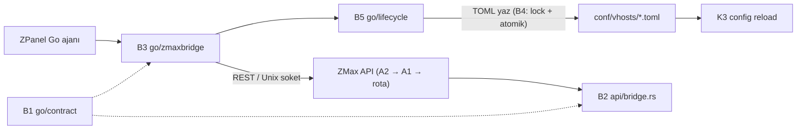

# ZMax ↔ ZPanel (Go) Köprüsü — 5 Parça (B1-B5), kodla eşlenmiş

Rust tarafı: `D:\zmaxserver\katmanlizmax\doc\agaclar\birlesme2\crates\zmax-bin\src\api\bridge.rs` (`main` = `birlesme2` = `dff16c6`).
Go tarafı ve sözleşme: **`D:\zmaxserver\katmanlizmax\go\`** (Go modülü `zmaxbridge`, `go 1.21`; `git ls-files` altında **izlenmiyor**). Plan yolu `bridge/go/zmaxbridge` (Karar 6) ile gerçek yol farklıdır; `bridge/` klasörü hiçbir ağaçta yok.
Panel kaynağına (`D:\lunixpanel\zpanel-tam`, `zpanelv2`) dokunulmaz.

## 1. Parça durumu
| Parça | Durum | Yer |
|---|---|---|
| B1 sözleşme | **Kısmi** | `go/contract/`: `openapi.yaml` (yollar: version, health, config/validate, reload, cache/purge — `events`, `status`, `security/*` **yok**), `vhost.schema.json`, `contract_version` (= `1.0`). **`golden/` yok**; Rust tarafında sözleşme testi yok (Rust `CONTRACT_VERSION = "1.0"` sabit, `api/bridge.rs:7`) |
| B2 Rust uç noktaları | **Var** | `api/bridge.rs` (112); ayrıntı §2 |
| B3 Go istemci | **Kısmi** | `go/zmaxbridge/` (client.go 202, models.go 53, errors.go 42, config.go 33, client_test.go 92) |
| B4 dosya sözleşmesi | **Kısmi** | Go: `go/lifecycle/writer.go` (`AcquireLock` 25 → `.vhost_write.lock`, 5 sn; `WriteAtomic` 46; `Backup` 81; `Rollback` 99). Rust API vhost yazımında `.lock` **yok** (`api/services/vhost_service.rs`) |
| B5 yaşam döngüsü | **Kısmi** | `go/lifecycle/lifecycle.go`: `EnsureCompatibility` 25 (sürüm denetimi), `ApplyVHostSafe` 50 (kilit → Validate → yedek → atomik yaz → Reload → hata/`generation` kontrolü → başarısızsa Rollback + Reload; `lifecycle.go:50-95`). ZMax düşünce kuyruğa alma ve `generation` ile uzlaşma yazılmadı |

## 2. B2 — Rust uç noktaları (`api/bridge.rs`, `api/routes/system.rs`, `api/services/config_service.rs`)
| Uç nokta | Durum | Yer |
|---|---|---|
| `GET /api/v1/version` | Var: `server_version`, `contract_version`, `supported_features` (`version, health, config_validate, reload_generation, events_sse`, 9. satır) | `bridge.rs:46` |
| `POST /api/v1/config/validate` | Var: gövde `{"toml_content": "…"}`; yanıt `valid`, `message`, `error_field`, `error_line`; yalnız `VHostFileDocument` ayrıştırır, **uygulamaz** | `bridge.rs:58` |
| `POST /api/v1/reload` yanıtı | Var: `ok`, `status`, `generation`, `vhosts_loaded`, `errors[]`; hata durumunda 500 + `errors:[mesaj]` (**hangi dosya** alanı yok) | `config_service.rs:13-40` |
| `GET /api/v1/health` | Var: `contract_version`, `generation` döner; **kimliksiz** (Karar 9'a aykırı) | `system.rs:14-34` |
| `GET /api/v1/events` (SSE) | Var, 15 sn ping. Yayılan olaylar: `vhost_applied` (`config/reload.rs:162`), `config_rejected` (`config_service.rs:29`), `ban_removed` (`security_service.rs:91`). **Yayılmayan:** `ban_added`, `cert_renewed` | `bridge.rs:89` |
Köprü uçları A2 → A1 zincirinden geçer (`api/mod.rs:116,121,136`); ayrı rol yok (Karar 7).
**Sözleşme farkı:** Go `HealthResponse` `uptime_sec` ve `generation` bekler; Rust health yanıtı ikisini de döner (`system.rs:20`); Go `Status` modeli `active_connections`, `total_requests`, `memory_usage_kb` bekler — Rust `status` yanıtı bu alan adlarıyla **karşılaştırılmadı** (Doğrulanmadı).

## 3. B3 — Go istemci yüzeyi (gerçek)
`NewClient` 27, `Version` 115, `Health` 134, `Validate` 146 (`ErrRejected{File, Field, Message}`), `Reload` 166, `PurgeCache` 190, `Status` 195. Tipli hatalar `errors.go`: `ErrUnavailable`, `ErrContractMismatch`, `ErrRejected`. **Yazılmayanlar (planda vardı):** `Events(ctx)`, `Ban/Unban`, yeniden deneme + artan bekleme, devre kesici (arama: yok). **Var:** Unix soket yolu ayarı (`config.go:9`) ve istek başına zaman aşımı, varsayılan 5 sn (`config.go:15,28`).

## 4. B4/B5 — kurallar (güncel)
- **Tek yazar:** Go yazar (`lifecycle.ApplyVHostSafe`); Rust API'nin vhost yazma uçları WebAdmin/CLI içindir ve **kilit almaz** — iki yazar çakışması riski kapanmadı.
- **Yazım:** Go: kilit → yedek → atomik yazma → `Reload` → başarısızsa `Rollback` (`lifecycle.go`).
- **Açılışta:** `EnsureCompatibility` → `Version()` ile `contract_version` MAJOR eşleşmesi (`ErrContractMismatch`).
- **Günlükler:** vhost başına `access.log`/`error.log` ZMax yazar (K5), NCSA Combined biçimi.
- **Geri dönüş:** `zmax-gecis.sh` ile OpenLiteSpeed'e dönüş kuralı bu belgede doğrulanmadı (kod dışı).

## 5. Sağlıklı çalışma ölçütleri (kabul)
| Ölçüt | Durum |
|---|---|
| Go `Reload()` dönüşü: `generation` arttı, `errors` boş | Kod var (Go modeli + Rust yanıtı); uçtan uca test: Doğrulanmadı |
| Bozuk TOML: `Validate` reddeder, dosya geri alınır | Kod var (`lifecycle.go`) |
| ZMax kapalıyken panel donmaz, 5 sn zaman aşımı | `ErrUnavailable` tipi var; varsayılan zaman aşımı 5 sn (`config.go:28`) |
| Sözleşme sapması testle yakalanır | **Yok** (golden dosyaları ve Rust sözleşme testi yok) |
| Eşzamanlı yazım `.lock` ile | Yalnız Go tarafında |
